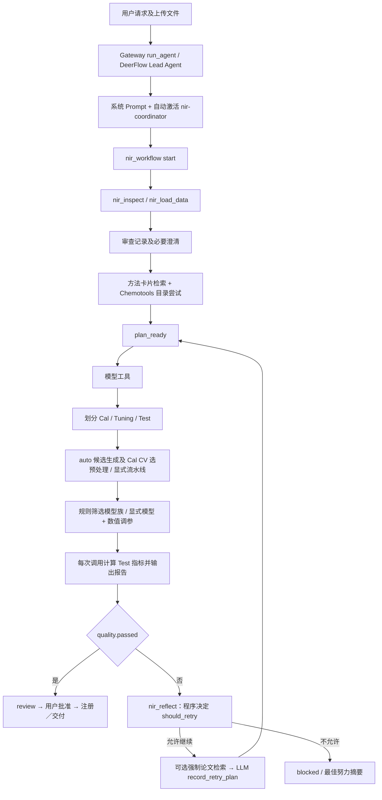

# ChemAgent 当前决策机制源码审查报告

审查日期：2026-10-08（Asia/Shanghai）

审查方式：本地源码及配置静态审查；未启动建模、LLM 服务或大规模实验。

配套文档：[机制设计](chemagent-llm-decision-design.md)、[实施计划](chemagent-implementation-roadmap.md)。

## 1. 审查基线与结论

用户给出的工作区是 `D:\ChemAgent`；实际 Git 仓库和本文路径基准是 `D:\ChemAgent\nirs-agent`，因此交付目录为该仓库的 `docs/`。

| 检查项 | 实际结果 |
|---|---|
| 当前分支 | `dev/Duan`，未切换分支 |
| HEAD | `ef288ea3ec241507c63164828a012a2fd519a440` |
| 提交 | `feat(nir): add process visualization and method knowledge workflows`；2026-10-08 15:47:30 +0800 |
| 本地远程跟踪 | `origin/Duan` 与 HEAD 相同 |
| 远程实时核验 | `git ls-remote --heads origin Duan` 返回相同 SHA；没有 fetch、pull、reset 或 checkout |
| 本地另一个分支 | `Duan` 为 `7e33fab`，落后远程一提交；不能据此认为当前工作区落后 |
| 审查前工作区 | `git status --short`、暂存及未暂存 diff 未报告改动 |
| 检查限制 | 两个 `backend/pytest-cache-files-*` 目录拒绝访问；它们不是本次业务源码依据，不能声称已检查其内部内容 |
| 仓库约定 | 已阅读根目录、backend 和相关 frontend AGENTS.md，以及 README、nir_core README；本轮仅新增三份 Markdown |

**核心判断：现有系统是“LLM 编排与有限显式提案 + 程序自动选择 + 数值参数搜索”，尚不是统一的 LLM 自主决策闭环。** LLM 可以选择工具、显式模型和合法预处理组合，失败后的计划也有绑定机制；但默认初始候选、自动模型族比较、候选采用阈值和继续／停止重试主要由确定性程序控制。[E01][E03][E05][E06][E10][E11]

**测试集问题已经存在于代码路径，不能只描述为理论风险。** `nir_compare` 按测试集 RPD 选最佳；质量门禁、潜变量建议及反思读取测试信息。三集物理分开、单个自动选择函数不接收 Test，并不能保证整个多轮任务的最终独立性。[E08][E09][E10][E15][E16]

本文不把仓库说明中的“autonomous”直接等同于“LLM 决策”。也不把源码支持等同于本机服务已运行、在线 MCP 已连接或某次真实任务已经执行。94 是打包方法卡片数量，运行中管理员管理快照可能不同。

## 2. 完整建模调用链

1. Gateway 的 `run_agent()` 执行图并用 `NIRStreamMessageGate` 控制 NIR 文本发布；Lead Agent 由 `create_agent()` 绑定 LLM、工具、Prompt、ThreadState 和中间件。[E01][E21]
2. `get_available_tools()` 从实际 AppConfig 加载社区工具，并组合内置和 MCP 工具。检查到本地 `config.yaml` 的 NIR 工具提供者与示例注册路径一致；没有读取或输出模型密钥。[E22]
3. `build_middlewares()` 用关键词／工作流状态自动路由 `nir-coordinator`，安装 `NIRWorkflowMiddleware`。这一步是任务路由规则，并非模型管线决策。[E01]
4. LLM 调用 `nir_workflow(start)`；程序检查任务、先决输入、max_attempts，并转入 data_audit。审查后缺失的专业条件进入 clarification，否则进入 planning。[E11]
5. 首轮方法检索主要由 Prompt／Skill要求；Chemotools 目录“已经尝试”由中间件硬校验。正式自动训练内部会再次在 Cal 上检索方法卡片。[E03][E12][E14]
6. 成功解析且含passed布尔值的工具结果通过中间件写入 attempts、attempt_evidence、protocol、metrics_summary、选择事实和执行签名；质量通过立即进入 review，质量未通过进入 evaluation。抛异常或返回error不等同于这条质量分支。[E11][E12]
7. 质量未通过后 LLM 不能直接再次训练或提前终结：必须反思，必要时检索，再固化 retry_plan。实际请求不匹配计划会被拒绝，重复违规可能 blocked。[E11][E12]
8. 工作流及近期尝试通过 DurableContextMiddleware 重新注入 LLM；最终回答有证据校验，未完成流程的回答会被隐藏并重新唤起模型，持续违规关闭流程。[E13][E21]

**调用链中的真实覆盖／选择：**

- 当 LLM 请求 `pipeline_steps="auto"` 或 `method="auto"`，提交的是“授权程序选择”，最终管线或模型由程序产生；不是程序覆盖了一个已确定的具体 LLM 管线。
- 当 LLM 提交显式合法 `pipeline_steps` 和 `method`，核心训练入口会使用它们；`nir_train_model` 不自动改模型族。但模型内部超参数仍由内置搜索决定。[E06][E07][E15]
- `_select_model_family()` 即使收到显式非 PLS 方法，仍先训练 PLS 基线，再训练指定方法；最终结果一般使用指定家族，但额外基线成本不是 LLM 明确选择的实验。[E06]
- `_bind_reflection_request()` 明确覆盖 LLM 提交的 metrics_path、history、attempt、max_retries、domain，使其绑定持久证据。这是合理的证据约束；但被绑定的现有 metrics 包含 Test。[E12]
- 中间件可以替换缺少依据的最终文本；这属于输出真实性控制，不应被计为 LLM 自主模型决策。[E21]

## 3. Dataset Profile、方法检索和预处理选择

### 3.1 Dataset Profile 如何产生

`profile_preprocessing_data(X, wv)` 计算样本数、波长数、轴是否存在／规则、尖峰比例、基线斜率相对幅度、高频二阶差分相对幅度、逐谱标准差变化。固定阈值将它们转成 isolated_spikes、baseline_drift、high_frequency_noise、low_signal_to_noise、scatter_variation 标签。[E02]

这些量是工程诊断代理，不是噪声、基线或散射成因的确证。尤其残差趋势也不能唯一定位光学原因。新模式可保留其数值计算，须向 LLM 同时提供指标定义、作用范围和不确定性。[E02][E17]

正式 `select_preprocessing()` 只接收 Cal/Tuning，Profile 来自 Cal。独立的 `nir_recommend_preprocessing(input_path)` 则对调用者提供的整个 NPZ 计算 Profile，输出标注 exploratory_input_only；若输入包含 Test，LLM 仍可能看到混合数据诊断。工具说明“训练时重算”并不能撤回先前进入模型上下文的观察。[E03][E18]

### 3.2 四个步骤必须分开

| 步骤 | 当前实现 | 实际主导者 |
|---|---|---|
| 方法知识检索 | `MethodKnowledgeBase.search()`：发布状态、FTS5 BM25、双语词扩展、匹配诊断标签、priority 与相关性排序 | 确定性检索程序；查询文本可由 LLM 提出 |
| 候选管线生成 | `recommend_preprocessing()`：固定条件组合、项目参数变体、检索方法单步变体、预算截断 | 程序；没有在此调用 LLM |
| 候选方案执行 | `nested_cv_preprocessing()` 对各候选执行 PLS 内部 CV及 Tuning 预测 | 数值程序 |
| 最终预处理选择 | Cal RMSECV 最优的 1% 范围内选更简单的方案 | 固定采用规则 |

检索分数不是效果概率。代码按匹配标签权重、精确名称、priority、BM25、原序号排序；带 Profile 时排除非预处理卡片及没有匹配标签的卡片。`retrieve_method_plan()` 无诊断标签、无可执行结果或检索异常时返回 rule_fallback。[E03]

候选生成先建立 raw 对照，按诊断添加 AsLS／detrend、SNV／MSC、SG 等固定组合；检索候选按参数变体轮转后置于规则候选前，并为 raw 和旧规则对照留位置。预算为 small 4、standard 8、extended 12 个候选，步数 2／3／3。生成及截断顺序会影响实际尝试范围。[E02]

`select_preprocessing()` 固定 standard、inner_folds=3、max_components≤10、seed=42、selection_rule=rmsecv_1pct。`nested_cv_preprocessing()` 还计算 `0.7*cv_r2+0.3*val_r2`，但当前四个主回归入口通过本 helper 使用的是 Cal RMSECV 1% 简洁性规则；不能误报它们以加权 R²作为最终选择公式。加权 score 仍在证据字段中，legacy_score 可使用它。[E04]

### 3.3 方法卡片内容与执行能力边界

卡片包含 method_id、method_kind、用途摘要、适用性、局限性、参数指导、问题／避免标签、candidate_params、planning_notes、priority、review_status、官网链接／章节、文档和运行时版本等。检索补充 runtime_parameters、provider 绑定、auto_eligible、eligibility_reason、matched_tags、rank_score、content_sha256、evidence_id、untrusted_evidence。[E03][E19]

`MethodCatalogStore` 在应用数据目录的 knowledge/methods.sqlite3 保存管理快照及修订历史；打包 JSON 是种子，读时合并缺失新卡片但不回写数据库。管理修改有 revision 及事务校验；运行实现、provider 和真实运行时范围不由卡片编辑改变。`ManagedMethodKnowledgeBase.search()` 在检索时读取该快照。[E19]

打包库有 94 条卡片：包括21种普通预处理的引用、4种模型参考及更广的 Chemotools MCP 引用。**卡片存在不等于 NIR 管线可执行。** `method_registry.py` 明确不是执行注册表；model_pls／model_ridge／model_svr／model_extra_trees 是规划引用，MCP 引用可能仅文档可用。模型卡片 candidate_params 不会传入现有模型搜索网格，也不能满足论文库的“两项独立研究”门槛。[E03][E18][E19]

### 3.4 LLM 在预处理中的实际权限

LLM 能调用检索及方法 describe 工具，也能在显式入口提供任意已注册、合法、有顺序的 JSON 步骤与参数，不仅限于默认候选。例如 Raw 用 `[]`，SNV + SG 的窗口参数可明确提交。`validate_pipeline()` 检查白名单、阶段顺序、互斥和参数；方法具体 schema 来自 registry，而非 Skill 的静态示例。[E15][E18][E20]

因此“LLM 完全不能选预处理”不成立；**默认自动路径的初始预处理不由 LLM 选定**才是准确表述。检索卡片提供知识，显式选择接口提供部分决策权限，两者尚未构成强制的、完整的决策记录合同。

## 4. 当前模型选择机制

可执行模型家族在 `_MODEL_METHODS` 和 `_train_one_model()` 分发中包括 pls、pcr、svr、rf、et、gbm、ridge、lasso、elasticnet、knn、mlp、cnn 共12种；CNN 有依赖预检。这是现有白名单／分发能力，还没有统一的“模型参数能力注册表”。4种模型知识卡片不是12种训练算法的同义替代。[E05][E06][E19]

默认 CSV 自动划分、固定分区及 `nir_analyze` 用 auto 选择模型。先训练 PLS 基线，程序由 Cal 样本数、变量比及 Tuning R²筛选候选：[E05][E06]

| 触发 | 程序行为 |
|---|---|
| Cal<30 或不能形成 baseline_r2 | 仅 PLS |
| 特征／Cal样本比≥0.5，或 PLS Tuning R²<0.9 | 加 Ridge |
| PLS Tuning R²<0.9 且 Cal≤max_svr_samples（默认1500） | 加 SVR |
| PLS Tuning R²<0.75 且 Cal≥80 且≤max_tree_samples（默认2500） | 加 Extra Trees |
| 最佳替代模型相比 PLS 的 Tuning RMSE 改善不足1% | 保留 PLS |

这一路径按 PLS、Ridge、SVR、ET 的程序候选顺序执行；不是 LLM 基于卡片比较后逐轮决定切换。显式非 auto 选择则只将该方法纳入最终家族候选，但 helper 仍会额外拟合 PLS 基线。[E05][E06]

波长选择也有同类控制权：程序先建立全谱基线，再按样本数、变量数、变量／样本比、Tuning质量触发 CARS，默认至少改善0.5% 才采用。虽不属于本次核心方法创新，也必须在新模式关闭隐式 auto，否则模型输入管线仍有未记录的程序决策。[E05]

**判断：默认模型选择时，LLM 主要负责调用自动选择工具；显式模式下，LLM 可决定模型家族。二者须分开记录。** 当前 Skill 快速 CSV 路径还要求默认省略 method，只有用户指定算法才传 method，这比底层工具的技术能力更限制 LLM 主动选择。[E14]

## 5. 当前参数优化机制

| 参数层次 | 已实现能力 | LLM 可控制程度 |
|---|---|---|
| 预处理参数 | JSON步骤、registry schema、合法性检查；自动候选有固定 project search values | 显式模式可给具体参数；auto 时程序决定 |
| PLS/PCR 成分 | `train_pls` 等可接收固定 n_components，也可内部 CV 搜索 | backend 公共工具仅给 max_components／CV选项；`_train_one_model` 总传 n_components=None，不能用“最大值”等同固定成分数 |
| SVR | StandardScaler→SVR；GridSearchCV 搜索 C=[0.1,1,10,100]、gamma=[scale,0.01,0.1,1] | 公共接口未暴露 C、gamma、epsilon 或 search_space |
| Ridge/Lasso/ElasticNet | StandardScaler + GridSearchCV；alpha及l1_ratio内置网格 | helper 有 param_grid，公共 train_ridge 等与工具分发未提供用户网格 |
| RF/ET 等 | GridSearchCV；例如树数[100,200]、深度[None,10] | 公共 NIR 工具未提供树参数或网格 |
| 搜索预算／策略 | 每次工具有资源限制和CV配置；内部数值搜索 | 没有跨轮 fit_count／trial_count 合同，也没有 LLM 指定 optimizer、区域扩展、局部搜索预算的统一接口 |

以上证据见 [E06][E07][E23]。检查到多种 GridSearchCV 和 PLS 成分枚举，未在本次模型／NIR工具范围发现 Optuna、Hyperopt 或 BayesSearchCV；不应据此声称整个仓库没有任何优化代码。

CSV两入口有一个容易忽略的行为：候选家族和波段在 Cal/Tuning 上选择后，合并 Cal+Tuning 拟合预处理，再调用 `_train_one_model()`，重新CV搜索成分或网格参数。故最终测试评价的是重新搜索后的工件，而 Tuning 结果属于前一拟合；不能把它们标为同一个冻结配置的前后指标。这不直接使用 Test 拟合，但影响方案一致性和反馈解释。[E08]

## 6. 反思与多轮优化

`nir_reflect` 没有调用 LLM。回归路径读取完整 metrics.json，调用 `suggest_lv_adjustment()`、`should_retry()`、`get_next_pipeline()`，给 LLM 诊断和确定性建议。[E10]

程序控制如下：[E10][E23]

- passed=true → 不重试；attempt≥max_retries → 不重试。
- 两个历史 R²之差绝对值<0.02 → 不重试；这里比较的是历史前两条，不含当前指标，且不等于“连续两轮相对最好模型无收益”。
- 配置候选顺序中第一个未出现过的方法序列作为 fallback；历史去重只看方法名称，不看具体参数。
- 固定候选耗尽时，即使 LLM 可能提出别的合法组合，也把 retry 覆盖为 false。
- 成分数建议依赖 RMSEP/RMSECV、test.bias、R²门槛；建议增加／减少成分不等于工具能够直接接收 suggested_n。
- `nir_reflect.best_so_far` 回归按 RPD 找最优；此字段来源于 Test，而不是验证RMSE。

残差数值由 `nir_core.diagnostics.compute_residual_diagnostics()` 计算。`nir_train_model` 和 `nir_compare` 的 diagnostics 使用验证 y/pred；但反思同时读取全量测试指标，所以“残差用 Val”并不足以实现决策隔离。[E15][E16][E17]

`_build_knowledge_hint()` 按未知领域、grade∈{C,D,F}且attempt≥2、R²<0.7生成固定查询。当前 `evaluate_quality()` 实际等级是 excellent/good/fair/poor，因而字母等级触发对这些新指标不会命中；未知领域及低R²分支仍可工作。这是需修正的接口语义问题，不是 LLM 自主知识需求判断。[E09][E24]

工作流最多10个 attempt，默认3；不是3次之外再加1次首轮。通过质量立即进入 review，失败才允许 reflection。若反思决定不继续则 blocked；当前状态没有独立的“LLM主动STOP”合同。Skill 快速 CSV 段落禁止再次调用 reflect，与中间件对失败强制 reflect 存在指令冲突；实际执行权限以中间件约束为准。[E11][E12][E14]

## 7. record_retry_plan 的复用价值与不足

已有计划存储 tool_name、method、pipeline_steps、model_args、diagnostics、evidence_ids、rationale、expected_improvement、execution_signature，并在执行前检查参数签名一致。这是真实可复用基础，不应重做一套独立计划系统。[E11][E12]

限制也很明确：

1. 仅规划失败后的重试；首轮没有同等强制计划。
2. 必须有最新 reflection.should_retry=true；LLM 不能突破规则继续探索。
3. pipeline_steps 必须非空，所以 Raw `[]` 不能直接作为 retry_plan；auto 字符串也不是这个合同支持的显式步骤数组。[E11]
4. 只比较上一轮 execution_signature，未阻止重新尝试更早历史；签名还包含许多调用语义而非单纯物理管线，需重新界定实验等价性。
5. 检查的是调用参数，不是全部最终拟合参数；auto输出及最终重新搜索未与 LLM 确切配置形成相等性检查。
6. 同一源 attempt 的 ready 计划可被替换为 superseded，历史记录有保留；但还没有专用不可改写的“执行前决策快照 + 实际执行 + 后验反馈”存储合同。

## 8. 实验历史、反馈和可视化

`record_attempt` 存储请求方法及 pipeline/model_args、selected_method、metrics_summary、decision_facts、工件路径、protocol、validation_scope、retry_plan_id；中间件只对成功解析且存在 passed 布尔值的建模结果生成这种 attempt。[E11][E12]

执行错误有 tool_observations；四个主要回归入口的 ProcessStore 也有失败／取消／中断记录。但失败模型并不必然以完整配置、失败假设和预算成本进入统一 attempts 表。不能将“错误工具消息存在”当成完整实验学习账本。[E12][E25]

`workflow_agent_view()` 提供近期最多10个 attempts、当前reflection／retry_plan／knowledge_evidence。DurableContextMiddleware 以隐藏 HumanMessage 数据块重新注入，NIR JSON文本上限6000字符。这已使 LLM 可读任务内历史、根据失败诊断提出不同方案；但摘要可能截断，attempt投影不包含所有实际搜索参数、成本、完整失败原因和预期兑现结果。[E13]

process.py 的 SQLite 索引保存 runs、attempts、steps、charts、events 和 agent_runs（user_version=2），图表为内容哈希文件，按 owner/thread 隔离且不在sandbox-visible user-data。Gateway有 owner-checked 查询、分页和chart校验；前端已有过程、选择证据和结果展示，可扩展数据合同而无需重做网页。[E25][E26]

另一个实际接口限制是 `nir_compare`：它的all_metrics.json是summaries数组（modeling.py L2031–2034），中间件将该路径绑定为反思metrics_path（middleware L884–887），但nir_reflect加载后按dict调用metrics.get（reflect.py L142–153）。因此比较结果质量未通过时，不能直接复用当前反思读取合同；会返回类型错误，而不是得到正常重试决策。其返回也没有最佳模型的model_path／可信工件，所以不能假定“比较最佳”可以原样进入注册。新实验工具应输出单实验对象和对应工件，比较工具的展示能力单独保留。[E10][E12][E16]

目前 process 导出包含 all光谱／目标分布、各分区分布、train/val/test指标和holdout预测／残差图，并且已有 adaptive_holdout_warning。提示警告是诚实记录，仍不是测试访问权限屏障。[E25]

## 9. 关键决策控制权清单

| 关键选择 | LLM | 固定程序／数值优化器 | 与目标差距 |
|---|---|---|---|
| 任务类型、工具、专业信息提取 | LLM提交 | 工作流审查阶段和必要字段约束 | 可复用 |
| 初始auto预处理 | 仅调用auto | 规则／检索候选 + CalCV + 1%选择 | 应改为LLM显式方案 |
| 显式预处理组合及参数 | 可以 | 程序校验和训练执行 | 缺首轮决策快照 |
| 初始auto模型家族 | 仅调用auto | PLS基线及0.9/0.75等筛选和1%采用 | 高层控制权未交给LLM |
| 显式模型家族 | 可以，Prompt有额外限制 | helper额外PLS基线，指定家族执行 | 新模式去掉隐藏基线 |
| 具体模型超参数 | 可调整最大成分/CV等外围参数 | 内置CV／网格 | 需固定参数和可控搜索范围 |
| 波段选择auto | 可请求／关闭auto | 固定CARS触发和0.5%采用 | 新模式禁止隐式auto |
| 下一轮合法预处理／模型提案 | retry允许时可以 | 计划绑定、执行合法性 | 可复用并扩展 |
| 继续探索或停止 | 无统一主动决策接口 | passed、plateau、候选耗尽及预算规则 | 应由LLM选择，硬预算独立 |
| 保留历史最佳 | 可叙述比较 | 反思最佳按Test RPD；注册绑定当前已批准attempt | 需LLM提交保留选择及验证依据 |
| 请求额外知识 | 可以调用，但受阶段限制 | hint及knowledge阶段推进 | 需按LLM需要允许planning/evaluation查询 |
| 执行失败后切家族 | 受限制 | 显式失败模型的替换要求最新用户明确批准 | 应区分用户强制家族和LLM自选家族 |

表中模型失败保护的实际判断依据是工具请求 method 是否非auto，而不是“用户是否强制要求该家族”。这会将未来 LLM 自选显式模型的失败也当成需用户批准的替换，必须增加 selection_origin／user_model_constraint。[E12]

## 10. 验证协议与泄露问题逐项核对

| 用户关切 | 源码结论 |
|---|---|
| 是否提前计算最终Test | 每次 `nir_train_model`／`nir_analyze`／CSV训练都会计算并输出，尚未有任务级冻结后一次评估屏障 [E08][E15] |
| evaluate_quality是否用Test决定继续 | 是。R²常来自Val，RPD和RMSEP来自Test，bias优先test.bias；passed／action随后决定工作流分支 [E09][E11] |
| nir_reflect是否读Test | 是。读取完整metrics并经潜变量建议、质量、RPD最佳选择使用Test [E10] |
| 参数建议是否使用Test | 是。RMSEP>2×RMSECV、test.bias触发建议，甚至提出按Test bias校正预测 [E10] |
| 下一轮LLM能否看到Test | 能。工具直接返回RPD/RMSEP/holdout/external；attempts与持久注入再次提供；报告和图表也有Test [E12][E13][E25] |
| 多轮是否间接用Test选模型 | 是。测试相关质量影响继续机会，反思best按Test RPD，LLM可看到后再提方案 [E10][E11] |
| 是否存在直接Test选候选 | 是。`nir_compare` 的best_idx由m["RPD"]更新，而m["RPD"]来自test [E16] |
| 单次auto家族／预处理是否直接用Test | 主要选择helper不接收Test；采用CalCV或Tuning。必须保留这个局部优点，但不能据此宣称任务全程无泄露 [E03][E05][E06] |

另有四类验证语义问题：

- **内部CV边界：** 自动预处理选择的 `_pls_cv_best_components()` 在每折重新拟合预处理，是正确的；后续 `_train_one_model()` 接收在整个Cal上已拟合并变换的数据，内部CV不再重新拟合外层MSC／EMSC／scaling，可能泄露Cal内部留出折统计。不是Test泄露，但可能令RMSECV偏乐观。[E04][E06][E07][E15]
- **分组边界：** CSV三分区可按group隔离，但上述核心CV splitter只用KFold／LOOCV，没有groups参数；组关联不能只在三分区隔离后就认为内部CV也隔离。[E07][E27]
- **指标命名：** CSV入口把 `RMSECV` 设置为Tuning RMSE，固定分区Val仅保存RMSE，R²由该MSE及Tuning方差导出；不是独立的内部CV RMSE。新合同须分清train_cv、validation、final_test。[E08]
- **划分稳定性：** 现有每次工具可以接收不同 split参数、不同入口；相同seed不保证跨入口相同partition。任务内需冻结split_manifest，并禁止把之前Test划入后续Cal。[E08][E15][E27]

修正不能只删JSON中的test键。RPD、RMSEP、grade、passed、action、LV建议、历史best、图表、报告、文件读取、MCP输入及原始上传都可能传递测试信息。详细的接口和访问控制方案见机制设计第4、10节。

## 11. 可直接复用的能力与需要改变的边界

| 保留／复用 | 必须改变 |
|---|---|
| 数据加载、schema置信度与scientific_validation | 搜索工具只接收Cal/Val句柄，task级冻结划分 |
| Cal数据Profile、残差数值计算 | 不把标签或残差解释绑定固定优化动作 |
| 方法卡片、管理快照、FTS检索、provider版本 | 卡片是证据；新模式不按retrieval priority预定执行 |
| preprocessing.registry及fit/transform/provider回放 | 每折完整管线拟合；合法性拒绝不能悄悄换方法 |
| 12种训练实现、现有GridSearchCV/成分枚举 | 加参数schema、固定params／search_space／fit预算接口 |
| ThreadState、工作流、计划签名、取消/资源检查 | 首轮及后续统一decision合同；质量通过不自动结束搜索 |
| ProcessStore、owner API、结果事实、报告/ZIP | 插入执行前不可变决策和后验feedback；搜索阶段无Test |
| 注册、模型哈希和metrics绑定、预测/漂移监测 | 仅final_test工件注册；冻结后不因Test失败重新打开搜索 |

现有 ResourceBudget 约束文件／样本／变量／估算内存、deadline及取消，且在安全阶段checkpoint检查；它不记录每次CV fit，也不是任务累计的模型拟合预算。长单次fit的中断仍是协作式，不能承诺准确的强制超时。[E23]

## 12. 与目标创新点的具体差距及审查边界

需要补齐：统一Cal/Val决策上下文；初始及后续不可变决策快照；LLM比较候选后提交动作；模型固定参数和局部搜索空间；显式历史保留模型选择；完整失败／成本反馈；主动STOP及独立硬预算；执行配置一致性验证；冻结后一次Test与注册绑定。不存在通过“加长Prompt”就能解决上述工具和状态合同缺口的依据。

推荐在现有单目标回归链先实现 `llm_autonomous`，保留 `legacy` 的编排与规则能力，统一修复验证污染。分类、多目标、MAT集合不应被悄悄路由回legacy后宣称新模式；未完成对应适配时应明确不支持。当前分类反思也直接使用holdout指标，需一并限制重复最终测试，但本轮不扩展研究任务。[E10]

本轮没有运行既有测试、真实LLM闭环或连接live Chemotools；结论是源码能够证明的行为及风险。后续应实施小规模功能验证，不能把本文当成新机制已实现或实验证明其提高精度。

## 源码依据索引

以下路径相对仓库根目录；行号对应审查提交。链接固定到该SHA，不随分支后续修改漂移。

| 编号 | 文件、函数与行号 |
|---|---|
| E01 | `backend/packages/harness/deerflow/agents/lead_agent/agent.py`：`build_middlewares` L300–331；`make_lead_agent` 构造 L561–584 |
| E02 | `nir_core/preprocess/recommendation.py`：`PreprocessingDataProfile` L35–58；`profile_preprocessing_data` L145–198；`recommend_preprocessing` L231–535 |
| E03 | `nir_core/knowledge/methods.py`：`method_eligibility` L109–151；`MethodKnowledgeBase` L154–318；`retrieve_method_plan` L321–362；`_preprocessing_plan.py::select_preprocessing` L18–41 |
| E04 | `nir_core/model/evaluation.py`：`_pls_cv_best_components` L232–315；`_select_preprocessing_winner` L332–393；`nested_cv_preprocessing` L489–571 |
| E05 | `backend/packages/harness/deerflow/community/nir/candidate_selection.py`：模型白名单 L7–20；波段策略 L23–135；模型策略 L151–275 |
| E06 | `backend/packages/harness/deerflow/community/nir/single_target.py`：`_score_model_candidate` L56–86；`_evaluate_model_candidates` L89–124；`_select_model_family` L127–193；`_train_one_model` L201–404 |
| E07 | `nir_core/model/pls.py`：`_resolve_cv_splitter` L20–45；`train_pls` L59–189；`svr.py::train_svr` L24–108；`linear_reg.py` L23–102 |
| E08 | `backend/packages/harness/deerflow/community/nir/modeling.py`：CSV自动入口 L91–168、L297–333、L405–414；固定分区入口最终重训及指标 L807–888 |
| E09 | `nir_core/utils/metrics.py`：指标提取 L199–255；`evaluate_quality` L258–430 |
| E10 | `backend/packages/harness/deerflow/community/nir/reflect.py`：分类反思 L15–85；`nir_reflect_tool` L142–275；`nir_core/utils/validation.py`：`should_retry` L159–208、`get_next_pipeline` L242–271、`suggest_lv_adjustment` L274–431 |
| E11 | `backend/packages/harness/deerflow/community/nir/workflow.py`：`normalize_retry_pipeline_steps` L213–244；签名 L258–292；`start_workflow` L631–733；`transition_workflow` L885–1234 |
| E12 | `backend/packages/harness/deerflow/agents/middlewares/nir_workflow_middleware.py`：计划匹配 L374–421；替换保护 L424–498；授权 L641–808；反思绑定 L835–871；结果写回 L874–954；工具包装 L1194–1268 |
| E13 | `workflow.py::workflow_agent_view` L405–452；`agents/middlewares/durable_context_middleware.py`：投影与上下文 L63–99；`agents/thread_state.py`：结构 L26–94、证据合并 L221–253 |
| E14 | `skills/custom/nir-coordinator/SKILL.md`：workflow L123–157；MCP／首轮知识 L244–278；CSV默认路径 L418–447；重试 L599–704 |
| E15 | `community/nir/single_target.py::nir_train_model_tool`：公开接口 L743–815；划分／预处理／训练 L864–941；指标 L978–987；quality／诊断 L1016–1027；`modeling.py::nir_analyze_tool` L1274–1343 |
| E16 | `community/nir/modeling.py::nir_compare_tool`：Test指标 L1939–1948；diagnostics L1949–1954；最佳选择 L1970–1986；返回 L2044–2063 |
| E17 | `nir_core/diagnostics.py::compute_residual_diagnostics` L19–117 |
| E18 | `community/nir/preprocess.py`：list/describe L16–147；recommend L150–200；`community/nir/knowledge.py::nir_search_method_knowledge_tool` L132–176 |
| E19 | `nir_core/knowledge/method_store.py`：可编辑字段 L25–50、校验 L72–128、读快照 L131–179；`method_registry.py` L1–173；`community/nir/method_catalog.py` L9–21；打包 `method_cards/chemotools-preprocessing-v1.json` |
| E20 | `nir_core/preprocess/pipeline.py::validate_pipeline` L494–551；`preprocess/registry.py`：SNV L297–314、SG L426–446、METHOD_REGISTRY L857、`validate_method_params` L975起 |
| E21 | `runtime/runs/worker.py::run_agent` L206起、NIR流控 L424–500；`agents/middlewares/nir_workflow_middleware.py::_guard_final_response` L1270–1376 |
| E22 | `tools/tools.py::get_available_tools` L41–112；`config.example.yaml` L860–994；`agents/lead_agent/prompt.py` L495–499 |
| E23 | `nir_core/model/rf.py` 网格 L22–85；`nir_core/config.py` 默认候选 L85–91；`nir_core/io/resources.py::ResourceBudget` L117–280；`community/nir/_resources.py` L16–59 |
| E24 | `community/nir/_knowledge_hint.py::_build_knowledge_hint` L27–93 |
| E25 | `community/nir/process.py`：四入口MODEL_TOOLS L27、ProcessStore L112–357、`regression_evidence` L416–584、生命周期 L599–682 |
| E26 | `backend/app/gateway/routers/nir_process.py` L18–84；`frontend/AGENTS.md` L65–124；`frontend/src/core/nir/process-contract.ts`、`process-selectors.ts`、`method-knowledge.ts` |
| E27 | `community/nir/data_splitting.py`：分组划分 L179–205；`select_autonomous_split` L210–304；`nir_core/model/evaluation.py::split_dataset` L44–113 |

[E01]: https://github.com/junwenchen08-del/nirs-agent/blob/ef288ea3ec241507c63164828a012a2fd519a440/backend/packages/harness/deerflow/agents/lead_agent/agent.py#L300-L331
[E02]: https://github.com/junwenchen08-del/nirs-agent/blob/ef288ea3ec241507c63164828a012a2fd519a440/nir_core/preprocess/recommendation.py#L145-L535
[E03]: https://github.com/junwenchen08-del/nirs-agent/blob/ef288ea3ec241507c63164828a012a2fd519a440/nir_core/knowledge/methods.py#L109-L362
[E04]: https://github.com/junwenchen08-del/nirs-agent/blob/ef288ea3ec241507c63164828a012a2fd519a440/nir_core/model/evaluation.py#L232-L571
[E05]: https://github.com/junwenchen08-del/nirs-agent/blob/ef288ea3ec241507c63164828a012a2fd519a440/backend/packages/harness/deerflow/community/nir/candidate_selection.py#L151-L275
[E06]: https://github.com/junwenchen08-del/nirs-agent/blob/ef288ea3ec241507c63164828a012a2fd519a440/backend/packages/harness/deerflow/community/nir/single_target.py#L56-L404
[E07]: https://github.com/junwenchen08-del/nirs-agent/blob/ef288ea3ec241507c63164828a012a2fd519a440/nir_core/model/pls.py#L59-L189
[E08]: https://github.com/junwenchen08-del/nirs-agent/blob/ef288ea3ec241507c63164828a012a2fd519a440/backend/packages/harness/deerflow/community/nir/modeling.py#L807-L888
[E09]: https://github.com/junwenchen08-del/nirs-agent/blob/ef288ea3ec241507c63164828a012a2fd519a440/nir_core/utils/metrics.py#L199-L430
[E10]: https://github.com/junwenchen08-del/nirs-agent/blob/ef288ea3ec241507c63164828a012a2fd519a440/backend/packages/harness/deerflow/community/nir/reflect.py#L142-L275
[E11]: https://github.com/junwenchen08-del/nirs-agent/blob/ef288ea3ec241507c63164828a012a2fd519a440/backend/packages/harness/deerflow/community/nir/workflow.py#L885-L1234
[E12]: https://github.com/junwenchen08-del/nirs-agent/blob/ef288ea3ec241507c63164828a012a2fd519a440/backend/packages/harness/deerflow/agents/middlewares/nir_workflow_middleware.py#L374-L954
[E13]: https://github.com/junwenchen08-del/nirs-agent/blob/ef288ea3ec241507c63164828a012a2fd519a440/backend/packages/harness/deerflow/agents/middlewares/durable_context_middleware.py#L63-L99
[E14]: https://github.com/junwenchen08-del/nirs-agent/blob/ef288ea3ec241507c63164828a012a2fd519a440/skills/custom/nir-coordinator/SKILL.md#L599-L704
[E15]: https://github.com/junwenchen08-del/nirs-agent/blob/ef288ea3ec241507c63164828a012a2fd519a440/backend/packages/harness/deerflow/community/nir/single_target.py#L864-L1027
[E16]: https://github.com/junwenchen08-del/nirs-agent/blob/ef288ea3ec241507c63164828a012a2fd519a440/backend/packages/harness/deerflow/community/nir/modeling.py#L1939-L1986
[E17]: https://github.com/junwenchen08-del/nirs-agent/blob/ef288ea3ec241507c63164828a012a2fd519a440/nir_core/diagnostics.py#L19-L117
[E18]: https://github.com/junwenchen08-del/nirs-agent/blob/ef288ea3ec241507c63164828a012a2fd519a440/backend/packages/harness/deerflow/community/nir/preprocess.py#L16-L200
[E19]: https://github.com/junwenchen08-del/nirs-agent/blob/ef288ea3ec241507c63164828a012a2fd519a440/nir_core/knowledge/method_store.py#L25-L179
[E20]: https://github.com/junwenchen08-del/nirs-agent/blob/ef288ea3ec241507c63164828a012a2fd519a440/nir_core/preprocess/pipeline.py#L494-L551
[E21]: https://github.com/junwenchen08-del/nirs-agent/blob/ef288ea3ec241507c63164828a012a2fd519a440/backend/packages/harness/deerflow/agents/middlewares/nir_workflow_middleware.py#L1270-L1376
[E22]: https://github.com/junwenchen08-del/nirs-agent/blob/ef288ea3ec241507c63164828a012a2fd519a440/config.example.yaml#L860-L994
[E23]: https://github.com/junwenchen08-del/nirs-agent/blob/ef288ea3ec241507c63164828a012a2fd519a440/nir_core/io/resources.py#L117-L280
[E24]: https://github.com/junwenchen08-del/nirs-agent/blob/ef288ea3ec241507c63164828a012a2fd519a440/backend/packages/harness/deerflow/community/nir/_knowledge_hint.py#L27-L93
[E25]: https://github.com/junwenchen08-del/nirs-agent/blob/ef288ea3ec241507c63164828a012a2fd519a440/backend/packages/harness/deerflow/community/nir/process.py#L416-L584
[E26]: https://github.com/junwenchen08-del/nirs-agent/blob/ef288ea3ec241507c63164828a012a2fd519a440/backend/app/gateway/routers/nir_process.py#L18-L84
[E27]: https://github.com/junwenchen08-del/nirs-agent/blob/ef288ea3ec241507c63164828a012a2fd519a440/backend/packages/harness/deerflow/community/nir/data_splitting.py#L179-L304
