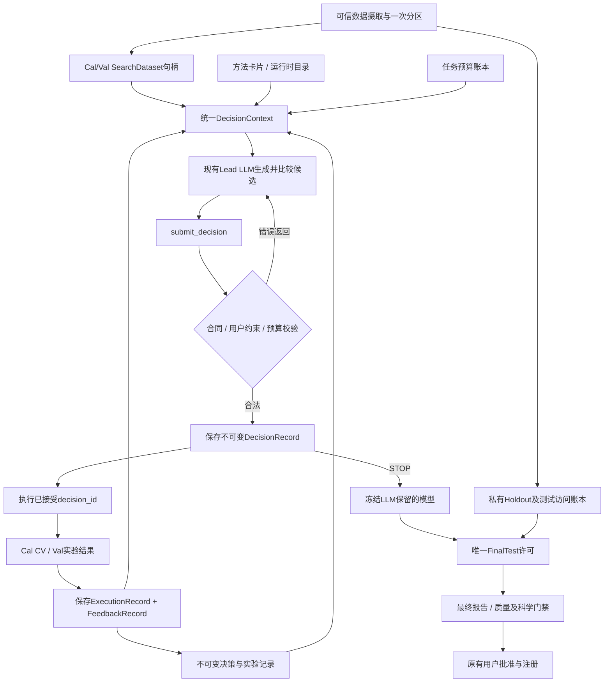
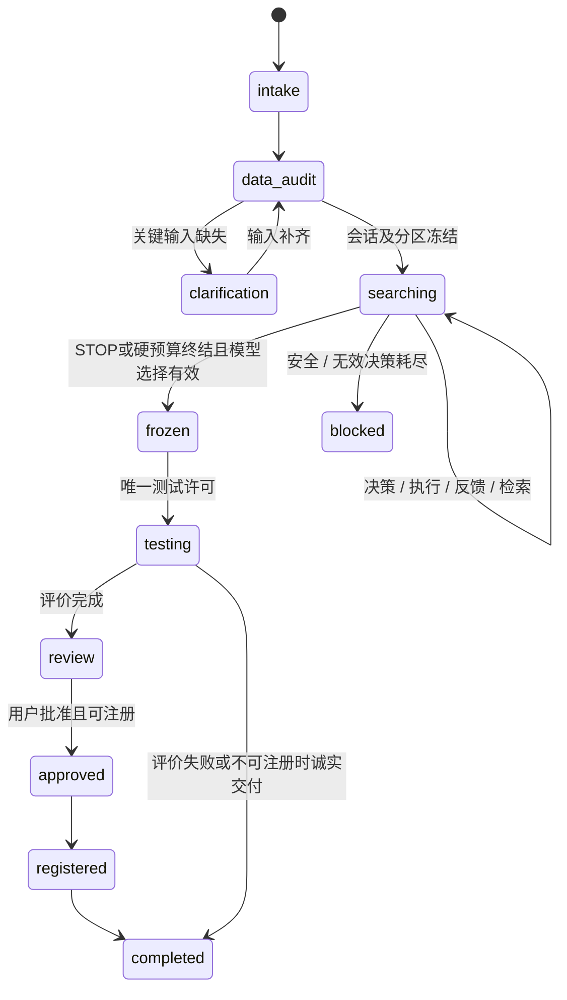

# ChemAgent 基于 LLM 的模型管线自主选择与优化机制设计

日期：2026-10-08；源码基线：`ef288ea3ec241507c63164828a012a2fd519a440`。

**本文全部新增接口、字段、状态和流程均为设计，尚未实现。** 已实现行为和行号依据见[源码审查报告](chemagent-current-decision-audit.md)；代码实施先后见[实施计划](chemagent-implementation-roadmap.md)。

## 1. 研究目标和适用范围

研究问题：让 LLM 结合任务、Cal 数据特征、方法知识、验证表现、任务内实验历史及预算，决定初始管线、后续优化层级、参数搜索区域、保留模型和停止时机。专业工具提供计算证据和执行能力。

方法贡献应体现在**可审计的控制权**：每个高层动作必须来自执行前保存的 LLM 决策；程序可以拒绝非法动作，但不能替 LLM 自动选择另一个模型、预处理组合或探索方向。数值优化器只在 LLM 授权的局部空间内选参数。

本阶段首先适配单目标回归；使用现有运行时预处理、建模和评估算法。分类、多目标、MAT集合等保留现有功能，其新模式能力必须逐项声明，不自动回退并冒称 LLM 自主。无跨任务经验记忆、迁移学习、强化学习、大规模多智能体、新论文基线或前端重构。

## 2. 新旧机制和职责

| 环节 | 当前主要路径 | 拟新增 llm_autonomous |
|---|---|---|
| 数据特征 | Cal Profile + 固定诊断标签 | 相同数值证据，注明定义、scope和不确定性 |
| 方法卡片 | 检索后按排序和参数变体生成auto候选 | LLM查询、比较及组合；排序只表示检索相关性 |
| 初始模型 | PLS基线及规则筛选其他家族 | LLM选择显式家族和合法管线，无隐藏PLS实验 |
| 高层采用 | 1%预处理、1%模型、0.5%CARS等规则 | LLM决定保留／尝试；规则仅作为参考知识 |
| 参数搜索 | 固定网格和CV | LLM指定参数、空间、优化策略和预算；局部优化器执行 |
| 后续优化 | 失败后规则should_retry → LLM试什么 | 每轮反馈后LLM决定TUNE／改变预处理／切家族／探索／停止 |
| 质量达标 | 自动review | 给出验证证据；LLM可以继续或STOP |
| Test | 每轮计算并反馈 | 冻结后一次评价；不可再进入搜索 |
| 留痕 | retry_plan + attempts + ProcessStore | 首轮／后续统一decision → execution → feedback不可变关联 |

LLM负责：观察与假设区分、候选生成与比较、选择动作、确定管线和局部搜索、选择保留实验、决定证据需求和主动STOP。程序负责：分区和访问权限、描述性统计、合法性及用户要求校验、训练／CV／数值搜索、指标计算、资源限制、可靠持久化、取消、注册安全和输出证据校验。

允许程序排序验证RMSE以提供性能榜单；不允许程序依据榜单自动改写 LLM 的最终保留选择。允许局部优化器按约定目标挑选当前模型的超参数；不允许它跨模型家族或改变预处理搜索区域。

## 3. 总体架构：接入现有控制平面



沿用 Lead Agent 的工具调用循环和 ThreadState，不新增独立 Agent 框架，不再套一个负责替它选动作的“决策Agent”。最小新增组件为：合同、上下文投影、实验工具／执行适配、分区访问服务、局部搜索适配、任务预算；不可变记录优先扩展现有 ProcessStore。

对源码的接入依据：`lead_agent/agent.py` L300–331和L561–584已有中间件与工具装配；`workflow.py` L1107–1186已有计划保存；`nir_workflow_middleware.py` L374–421已有签名守护；`process.py` L112–357已有持久索引；`durable_context_middleware.py` L63–99已有每轮状态注入。新机制扩展这些边界。

## 4. 分区与数据访问合同先于决策实现

### 4.1 一次划分，任务内冻结

可信摄取阶段在 LLM 形成模型方案前完成 dataset解释、分区、组和泄露检查；只向模型返回结构／目标名称／单位／样本计数及可用能力。Cal Profile只能在分区完成后产生。

`SplitManifest`至少包含：session_id、source_hash、interpretation_hash、目标／列解释、axis_hash、Cal/Val/Test成员哈希、split_strategy、seed、group_policy、CV fold_manifest、validation_scope、版本。原始成员索引及Test内容只在私有存储中保存。任务内不允许LLM通过换比例、seed、CSV/NPZ入口或标签列重划分。

提供两个程序接口：

```python
# 拟新增程序接口；holdout_ref不进入LLM上下文
prepare_search_dataset(owner, thread, task, source_binding, split_spec) -> DatasetHandle
get_search_partitions(owner, session_id) -> (X_cal, y_cal, X_val, y_val, groups, wv)
open_final_test(finalization_lease) -> (X_test, y_test, wv)
```

搜索执行器的函数签名、数据对象和运行权限中都没有 Test。不是先调用旧工具评估Test再过滤输出。数据服务只为finalization提供单独访问能力；通用路径解析不能通过session_id获取holdout。

### 4.2 必须封闭的其他通道

旧上传、报告和工具允许访问完整数据。新模式从任务开始就建立独立工具策略：

- 上传列表仅提供结构化绑定／句柄；原始文件不能被通用read、bash、MCP、浏览器文件读取、view_image或子代理访问。trusted ingestion按用户提供的文件绑定解析，但不把完整raw path作为可消费参数传给LLM。
- 活动新模式中deny-by-default：只开放决策、Cal/Val诊断、方法目录、只读知识查询及受控实验工具；旧nir_train_*、nir_compare、nir_analyze、nir_preprocess及任意MCP fit/function执行均不得作为绕行入口。
- live Chemotools catalog／describe／validate仅核对能力；真实预处理由本地已验证provider在CV训练边界内执行。需要额外MCP执行能力时必须另建Cal/Val句柄适配，不能直接开放文件路径工具。
- 原始inspect/load/recommend的混合全样本target分布、y示例和Profile不进入搜索上下文；可信服务可以检查完整数据有限性、重复和分区交叉污染，只向LLM返回通过／失败及必要修正信息。
- 搜索阶段 ProcessStore、API、图表和报告只发布Cal/Val；无holdout预测、残差、目标分布或从Test推导的grade。Test图表在testing成功后发布，不能只靠前端隐藏。
- 历史消息、summary、workflow注入、工具错误和结果读取也应用scope白名单；不能在旧测试已曝光的同一上下文直接开启新模式。需新搜索会话及干净的模型消息投影，原始旧记录仍保留为legacy；已经用过的holdout不能重新声称独立。

当前中间件 L711–747已有原始文件read及分析脚本阻断，但bash只识别特定解释器，且metrics／report仍可读，不能视为完整安全边界。新模式要用工具能力和存储边界封闭这些通道，不能靠字符串黑名单或Prompt承诺。

### 4.3 数据划分不属于管线选模动作

分组隔离、命名分区和CV折属于验证协议；在任务开始固定。用户明确的官方划分优先，无法确定关键映射时沿用已有澄清机制。group有效性及防交叉泄露是硬约束；“SPXY可能适合某类数据”等是划分知识，不用于在搜索中反复改变独立测试集。

## 5. 统一决策上下文

所有上下文由运行时从可信记录构建，LLM不能自行提交current_best、remaining_budget或history。结构以allowlist投影，携带context_id／revision／context_sha256；服务器验证身份及版本，完整快照供审计，模型收到有界视图。

| 信息 | 来源和计算边界 | 更新时点 | 提供模块（拟改／新增） |
|---|---|---|---|
| task | 原用户请求、workflow专业条件、用户模型／预处理限制 | start／用户有效补充；重要约束变更需新会话 | workflow + decision_context.py |
| dataset_profile | profile_preprocessing_data(Cal,wv)；样本数、变量数、轴、噪声／基线／散射数值及定义 | split冻结后；变化只接受新会话 | dataset_session.py + recommendation.py |
| knowledge | published方法卡片、source、card_hash、snapshot_revision、适用性、局限、runtime schema | 检索完成；当前decision固定快照 | method_catalog.py + knowledge.py |
| capabilities | preprocessing.registry；新模型adapter能力；依赖、参数、axis／provider约束 | 会话启动；目录版本改变先失效旧context | decision_contracts.py / model adapter |
| current | 上次实际执行配置、train_cv及Val指标、Val残差；失败则无伪造指标 | 每次执行终态 | experiments.py + process.py |
| history | 成功／失败的管线、固定参数、搜索空间、试验参数、结果、失败码、差值、LLM先前预期 | 每次记录／反馈 | ProcessStore + decision_context.py |
| best | 程序计算best_validation_rmse统计；LLM先前选定retained_experiment_id单独保存 | 每次反馈／LLM接受决定 | process.py + workflow |
| resources | 总上限、已用／预留trial与fit、剩余秒数、LLM／检索轮数、取消状态 | 每次预留／fit／返还及重启 | decision_budget.py |

Profile中的scatter标签是观察代理。上下文应明确“成因未证实”，而不是把scatter_variation翻译为“必须SNV”。知识数据继续以untrusted_evidence标记，正文不能改变system权限或执行代码。

建议模型视图：当前结果、保留实验、验证RMSE最低实验、近期5条、各失败类型摘要及已试签名集合；完整历史按分页工具取回。不能用当前6000字符头尾截断作为新合同的唯一实现；截断应明确omitted_count／available_pages，关键预算和最优记录永不丢失。本阶段历史只绑定session_id，没有跨任务搜索。

```json
{
  "schema_version": 1,
  "context_id": "ctx-0004",
  "revision": 4,
  "context_sha256": "server-generated-digest",
  "session_id": "search-001",
  "mode": "llm_autonomous",
  "task": {"kind": "single_target_regression", "target": "protein", "unit": "%", "user_model_constraint": null},
  "evaluation": {"selection_scope": "validation", "objective": "minimize_rmse", "split_manifest_id": "split-001", "cv_manifest_id": "cv-001"},
  "dataset_profile": {"scope": "calibration_only", "n_samples": 120, "n_wavelengths": 700, "scatter_variation_score": 0.18, "tags": ["scatter_variation"]},
  "current": {"experiment_id": "exp-003", "validation": {"rmse": 0.48, "r2": 0.86, "rpd": 2.7}, "actual_method": "pls"},
  "history": {"retained_experiment_id": "exp-002", "best_validation_rmse": 0.45, "recent_ids": ["exp-001", "exp-002", "exp-003"], "omitted_count": 0},
  "budget": {"trials_remaining": 10, "fits_remaining": 62, "wall_seconds_remaining": 220, "decision_calls_remaining": 8},
  "knowledge": {"card_snapshot_revision": 3, "evidence_ids": ["method:snv:examplehash"]}
}
```

上述数值和ID仅为合同示例，不是本项目的实验结果。真实context需包含完整profile字段、实际执行配置及证据分页，不只发送这个简化示例。

## 6. LLM专家决策过程与初始选择

将用户建议的六步落实为对象和事务，保存**简洁的决策依据与可验证假设**，不要求保存模型私有思维链。

| 步骤 | 结构化字段／程序动作 |
|---|---|
| 分析问题 | observations引用真实指标ID；hypotheses记录待验证原因、支持证据及局限 |
| 提出动作 | alternatives中列出合法候选、差异、成本及预期价值 |
| 比较动作 | comparison_summary + 各candidate的未选原因；不使用固定加权函数替代LLM |
| 形成决策 | selected_alternative_id、action、execution、optimization、expected_outcome、rationale、evidence_refs |
| 执行验证 | submit成功先落盘；execute只接收decision_id，服务器读取已接受对象 |
| 再决策 | feedback引用原decision_id；预期与观察对照存新记录，再生成新context |

初始context没有实验指标。LLM从任务、Cal Profile、真实runtime能力和方法卡片生成初始方案；可以选Raw、复杂度较小的模型或有知识依据的组合，没有mandatory PLS或mandatory Raw实验。Raw基线的比较价值可写入方法知识和alternatives，是否花预算执行由LLM选择。

首轮用 `EXPLORE` 表示建立第一个方案，phase=initial；有明确实验历史后才允许TUNE、CHANGE_PREPROCESS和SWITCH_MODEL。每次默认只执行一条最终选中的管线；多个备选无需全部训练。推荐提出2–4个不同方向，证据支持唯一方案时允许较少候选并说明原因。

方法卡片检索到SNV不意味着只能选SNV。LLM可选择SNV+SG、MSC、Raw等任意运行时合法组合，显式填写顺序和参数，读取卡片局限及参数指导；执行器不按卡片priority添加候选。所有组合仍需真实registry校验。

尤其不能把 `method_eligibility()` 的 **auto候选资格** 当成新模式的完整合法性标准：explicit_only表示不进入旧自动候选，低SNR／avoid_tags通常是方法局限和风险证据。新模式应向LLM展示这些标记，让它决定是否值得显式探索；只有实际参数、数值／物理轴条件、用户硬要求及明确的安全政策才能拒绝执行。若某类方法确实需要用户授权，授权状态在capabilities中单列，不能由auto_eligible推断。检索新模式知识时也不按auto_eligible过滤全部卡片，模型引用查询不传会排除modeling卡片的预处理Profile筛选。

## 7. 决策输出合同

建议 `decision_contracts.py` 使用Pydantic严格模型：extra="forbid"、有限数值、有界字符串／列表、Literal动作、按动作判别的联合类型。Tool-call schema和最终服务端parse都校验，不能只期待provider支持strict JSON。

```python
# 设计接口的摘要，非现有代码
class DecisionProposal:
    context_id: str
    expected_revision: int
    phase: Literal["initial", "iteration", "final_selection"]
    action: Literal["TUNE", "CHANGE_PREPROCESS", "SWITCH_MODEL", "EXPLORE", "STOP", "REQUEST_KNOWLEDGE", "REQUEST_DIAGNOSTIC"]
    observations: list[EvidenceClaim]
    hypotheses: list[Hypothesis]  # hypothesis, evidence_refs, uncertainty
    alternatives: list[Alternative]  # id, action, plan_summary, cost, comparison
    selected_alternative_id: str
    rationale: str
    evidence_refs: list[str]
    base_experiment_id: str | None
    retained_experiment_id: str | None
    execution: PipelineSpec | None
    optimization: SearchSpec | None
    expected_outcome: ExpectedOutcome | None
    request: EvidenceRequest | None

class PipelineSpec:
    preprocessing: list[PreprocessingStep]  # []合法，顺序保留
    model_method: str  # 真实adapter ID；禁止auto
    fixed_params: dict
    wavelength_selection: ExplicitSelectionSpec  # 默认none；禁止auto

class SearchSpec:
    strategy: Literal["grid", "fixed"]
    search_space: dict[str, list]  # grid用显式离散集合
    max_trials: int
    max_fits: int
    objective: Literal["train_cv_rmse"]
    cv_manifest_id: str  # 已冻结，不由LLM换折来寻找更好分数
```

服务端补充decision_id、schema_version、author="llm"、LLM消息／tool_call_id、模型标识、时间、context哈希、规范化proposal_hash、status及budget_reservation_id；不允许LLM填写author或实际指标。author字段来源于真实调用身份，不能仅凭JSON自称LLM。

固定参数与搜索参数不能重叠；固定策略 search_space={}、max_trials=1。搜索参数只能作用于选中的模型或明确命名的预处理步骤；绝不能包含method列表让优化器选家族。初期可仅开放模型参数搜索，预处理参数由LLM逐轮显式修改；若开放步骤参数网格，也必须是LLM授权的固定组合内的局部空间，并完整计数。

### 7.1 多轮决策示例

```json
{
  "context_id": "ctx-0004",
  "expected_revision": 4,
  "phase": "iteration",
  "action": "SWITCH_MODEL",
  "base_experiment_id": "exp-003",
  "observations": [
    {"claim": "最近两次PLS参数搜索没有改善验证误差", "evidence_refs": ["feedback:exp-002:validation", "feedback:exp-003:validation"]}
  ],
  "hypotheses": [
    {"hypothesis": "固定预处理下可能仍有非线性关系", "evidence_refs": ["feedback:exp-003:diagnostics"], "uncertainty": "残差不足以确证；用同一分区SVR实验检验"}
  ],
  "alternatives": [
    {"id": "a1", "action": "TUNE", "plan_summary": "继续扩大PLS成分数", "estimated_fits": 16, "comparison": "已有相邻区域未改善，暂缓"},
    {"id": "a2", "action": "SWITCH_MODEL", "plan_summary": "保留SNV，比较SVR局部网格", "estimated_fits": 21, "comparison": "可验证不同家族的价值，预算足够"},
    {"id": "a3", "action": "STOP", "plan_summary": "保留exp-002", "estimated_fits": 0, "comparison": "当前可用，但尚有足够预算检验主要未验证假设"}
  ],
  "selected_alternative_id": "a2",
  "rationale": "保留相同预处理和分区，只改变模型家族，以验证非线性假设并避免同时改变多个因素。",
  "evidence_refs": ["feedback:exp-002:validation", "feedback:exp-003:diagnostics", "method:model_svr:examplehash"],
  "retained_experiment_id": "exp-002",
  "execution": {"preprocessing": [{"method": "snv", "params": {}}], "model_method": "svr", "fixed_params": {"kernel": "rbf", "epsilon": 0.1}, "wavelength_selection": {"method": "none", "params": {}}},
  "optimization": {"strategy": "grid", "search_space": {"C": [1.0, 10.0], "gamma": ["scale", 0.01]}, "max_trials": 4, "max_fits": 21, "objective": "train_cv_rmse", "cv_manifest_id": "cv-001"},
  "expected_outcome": {"metric": "validation.rmse", "direction": "decrease", "reference_experiment_id": "exp-002", "relative_change_target": 0.02, "hypothesis_test": "同分区验证误差下降才支持该家族更适合；未改善则证据不支持"},
  "request": null
}
```

这是拟新增参数接口的示例。**现有nir_train_model不能接收这份SVR搜索空间**，需要第9节的adapter。文中2%只是LLM当次预期，不能被执行器变成普遍采用／停止阈值。实际fit消耗以账本为准，不能信任estimated_fits。

### 7.2 STOP示例

```json
{
  "context_id": "ctx-0009",
  "expected_revision": 9,
  "phase": "final_selection",
  "action": "STOP",
  "base_experiment_id": null,
  "observations": [{"claim": "已试验的后续方向未优于保留方案", "evidence_refs": ["history:validation-summary"]}],
  "hypotheses": [],
  "alternatives": [
    {"id": "s1", "action": "EXPLORE", "plan_summary": "试另一家族", "estimated_fits": 25, "comparison": "剩余fit不足，当前证据也不足以支持此成本"},
    {"id": "s2", "action": "STOP", "plan_summary": "保留exp-002", "estimated_fits": 0, "comparison": "已验证且满足任务约束"}
  ],
  "selected_alternative_id": "s2",
  "rationale": "根据验证历史、已覆盖方向和剩余资源，结束搜索并保留exp-002。",
  "evidence_refs": ["history:validation-summary", "budget:ctx-0009"],
  "retained_experiment_id": "exp-002",
  "execution": null,
  "optimization": null,
  "expected_outcome": null,
  "request": null
}
```

## 8. 动作语义、切换模型和保留方案

| 动作 | 必需输入 | 允许变化 | 服务端校验与反馈 |
|---|---|---|---|
| TUNE | base_experiment_id、同管线、params／space、预算 | 该模型参数或已授权局部区域 | 保留预处理／family／split，返回具体搜索结果 |
| CHANGE_PREPROCESS | base_experiment_id、完整新步骤、显式模型、搜索计划 | 预处理组合／顺序／参数 | 真实registry合法；报告与base差异 |
| SWITCH_MODEL | base_experiment_id、新family、完整pipeline | 模型family，预处理默认保持 | 用户强制family不可违反；LLM自选失败可再决策 |
| EXPLORE | 完整新pipeline、新区域理由 | 未充分探索的合法区域，可联合改变 | 不按固定family顺序；检验与历史差异 |
| STOP | retained_experiment_id、验证依据、停止理由 | 不再训练 | 必须绑定本session成功工件；无成功模型时允许明确no_model终止 |
| REQUEST_KNOWLEDGE | query、method_cards或papers、问题、purpose | 不训练 | 查询允许planning/evaluation；仅新证据更新context |
| REQUEST_DIAGNOSTIC | allowlisted diagnostic、Cal／Val范围、问题 | 不改变拟合管线 | 只能计算已有数据的合法诊断；消耗诊断预算 |

合同中TUNE／CHANGE_PREPROCESS／SWITCH_MODEL必须提供base_experiment_id，并与本会话的实际配置比较；首轮EXPLORE和STOP可为null。不能隐式猜成最新实验，也不能用retained_experiment_id替代动作基准。

每个选动作都包含当前retained_experiment_id，表示LLM在看到反馈后选择保留谁；它可不同于当前实验。best_validation_rmse只是统计值，LLM若保留误差略高但更稳定／符合用户限制的工件，要给验证证据和未选更低误差方案的原因，不能调用Test支持取舍。

增加 `selection_origin=user|llm|legacy_rule|optimizer` 及 `user_model_constraint`：用户明确指定算法才是切换保护的依据。当前 `_pending_failed_model()` L424–437将所有非auto失败都视为需批准；新模式应允许LLM更换其自己选的失败家族，仍禁止违反用户硬要求或偷偷换成其他家族。

## 9. 参数优化：复用当前数值能力的最小扩展

### 9.1 推荐方式A

LLM选family、固定预处理、参数集合／空间、预算和是否扩展区域。内部训练CV评价搜索trial并按预先声明的train_cv_rmse选局部最优；该最优只在外部Val上评价，LLM据此决定高层动作。内部CV结果和Val结果分列返回。

优先复用现有 PLS/PCR 成分枚举、GridSearchCV、sklearn ParameterGrid／clone／splitter和模型构造，不引入Optuna等新框架。现有helper已提供训练实现，但缺少公共参数透传、全管线CV及fit计数，所以需要薄adapter，不能只往旧tool的model_args塞无法消费的字段。

建议 `nir_core/model/search.py` 为这些原语增加可控接口：

```python
run_bounded_search(
    X_cal, y_cal, *, groups, wv,
    pipeline_spec, search_spec, fold_manifest,
    before_fit, resource_checkpoint,
) -> SearchResult
# SearchResult: actual_params, trial_results, best_cv, cv_predictions_summary,
# actual_fits, failures, provider_manifest, fitted_pipeline
```

每个CV折从raw Cal子集fit完整预处理、波段选择及模型；状态型MSC／EMSC／scaler不能在全Cal上先fit再CV。监督式波段选择若开放，同样必须在折训练子集fit；初版可明确禁用监督波段搜索并设none，不能默认偷偷跑CARS。

GridSearchCV可用于无额外状态或已封装成可clone完整Pipeline的adapter；预算先预留候选×折+refit并通过counted fit钩子记账。难以在当前函数中插入该钩子的模型，用ParameterGrid和现有固定参数拟合逻辑枚举相同数值搜索，加入每次fit检查；这是对现有优化原语的薄封装，不是另建高层优化策略。

group任务使用已冻结的GroupKFold等fold_manifest；无法提供适配时拒绝该搜索能力，不能退回普通KFold。输出记录每折有效样本数、实际fit和数值失败；所有trial CV失败时显式失败，不能沿用 `train_pls()` L173–175的“全失败也选1成分”并声称成功。

### 9.2 方式B：LLM直接参数

strategy=fixed，LLM提交fixed_params，exact fit验证完整管线；可计算固定参数的训练CV，再在全Cal拟合并评价Val。CV及全Cal拟合都计fit预算。固定参数后不能再自动搜索或数值clamp，PLS成分超限需返回精确约束让LLM修正。

### 9.3 模型能力目录

新增模型adapter目录，以现有 `_MODEL_METHODS`／`_train_one_model` 的12家族为源，列出运行依赖、用户参数schema、fixed和grid支持状态、硬范围、成本及内部scaler行为。映射知识ID，例如model_extra_trees→et。不得把method_registry的参考schema当成执行schema；其中SVR gamma参考字段只允许字符串，而实际搜索已有数值gamma，须在执行schema中准确表达联合类型。

最初可先完成PLS、Ridge、SVR、ET四个adapter并返回明确支持清单，其余现有家族在legacy保持可用；任何新模式未支持family请求返回capability_not_supported，而不是替它改选PLS。后续逐一复用PCR、RF、GBM、Lasso、ElasticNet、KNN、MLP、CNN；不需重写算法。

## 10. 实验执行、反馈及最终测试

### 10.1 只执行已接受的决策

拟新增 `nir_submit_decision(proposal)` 返回decision_id；`nir_execute_decision(decision_id)`不接收额外method／pipeline／路径参数。服务端读取规范化计划和session的冻结分区；调用者不能在执行时改参数或直接填写结果。

执行前比较context revision、proposal_hash、provider版本、预算预留和lease；同decision_id重试只返回既有状态／结果，不能重复fit。规范化签名包含数据解释、split、fold、ordered步骤及参数、模型family、fixed_params、search_space、seed和provider版本，排除输出路径。

返回 `actual_execution_spec`，与授权合同比较：固定参数模式须一致；grid模式允许optimizer选择space内参数，记录选择原语和trial来源。任何隐藏auto、重排序、参数丢弃、隐式家族替换或重新搜索都返回execution_mismatch并使结果不可用于冻结／注册。

### 10.2 三种记录分开保存

| 记录 | 内容 | 不可变规则 |
|---|---|---|
| DecisionRecord | LLM observations／hypotheses／alternatives／choice／rationale／evidence／expected；规范化计划、context哈希 | 接受后insert-only；修正生成新ID和supersedes关系 |
| ExecutionRecord | decision_id、experiment_id、requested及actual_spec、状态、optimizer_trials、CV/Val指标、provider、artifact_hash、成本、失败码 | 追加开始和终态事件；相同事件幂等；不回写决策依据 |
| FeedbackRecord | 前轮和已保留方案的delta、best_validation_rmse、Val诊断、预期是否实现、假设验证证据、剩余预算 | 原预期原样引用；机器计算数值结果，LLM后续解释另存 |

失败也写全计划、消耗及有界错误；missing_dependency、invalid_data、numeric_failure、resource_exhausted、cancelled、execution_mismatch分开。不允许给失败trial造指标。LLM从这些证据决定缩小空间、查询能力或换方向，而不是程序强制指定替代模型。

```json
{
  "experiment_id": "exp-004",
  "decision_id": "decision-004",
  "status": "succeeded",
  "actual_configuration": {"method": "svr", "params": {"kernel": "rbf", "epsilon": 0.1, "C": 10.0, "gamma": "scale"}},
  "metrics": {"train_cv": {"rmse": 0.43, "folds": 5}, "validation": {"rmse": 0.44, "r2": 0.88, "rpd": 2.9, "bias": 0.01}},
  "delta": {"previous_validation_rmse": -0.04, "retained_validation_rmse": -0.01},
  "best_validation_rmse": 0.44,
  "diagnostics": {"scope": "validation", "residual_definition": "reference_minus_prediction", "residual_trend": "flat"},
  "cost": {"trials": 4, "fits": 21, "wall_seconds": 9.4},
  "expected_outcome_assessment": {"reference_experiment_id": "exp-002", "relative_rmse_improvement": 0.0222, "target_met": true},
  "failure": null,
  "test_status": "sealed"
}
```

这是示例结果，不代表实际运行。指标用完整精度保存，仅显示端舍入。现有diagnostics用reference-minus-prediction，而process残差图用prediction-minus-reference，必须记录符号并显式转换，避免LLM反向解释趋势。

### 10.3 冻结与一次独立测试

默认final_fit_policy=keep_calibration_fit：直接冻结LLM保留实验的已拟合pipeline/model，不再调参。这样其Val证据与工件完全相同，最小改动。

可选refit_train_validation必须在开始任务时声明；STOP先冻结完整选择配置和具体参数，随后仅在Cal+Val重拟合相同配置，不重新CV选成分、不改搜索区域。拟合后的工件hash在开启Test前固定。其搜索阶段Val证据标明selection_model，最终模型标明refit_model，不能把原Val指标冒称最终模型独立验证。

`FreezeRecord`包含：retained_experiment_id、decision_id、所有确定参数、预处理provider／state、选择波段、split_manifest_id、final_fit_policy、model_hash、搜索记录hash及停止来源。

最终测试只能由 `nir_finalize_model` 在frozen状态发起；test_consumption键是 **owner + session + split/holdout identity**，不能按model_hash允许换个模型再测试。原子地声明唯一lease后才能读取Test，重复调用返回同一已存结果。成功后testing→review/finalized；全部优化／知识指导再训练入口永久禁止。

持久化时采用单次访问保守策略：lease在读取前落盘；若崩溃后发现最终结果已完整提交，恢复原结果；若读取后状态不明且没有完整结果，记录final_test_failed，不能自动再次读取或重新打开搜索。可继续交付冻结工件并明确评价失败，后续恢复需可信运维处理。不要为追求可用性声称分布式场景天然exactly-once。

测试质量差可以阻止注册、要求补充独立验证或报告失败，**不能触发新一轮调参**。Test为最终评价，不是选择哪个候选值得保留的信号。

### 10.4 报告与注册兼容

搜索使用新的scope明确指标：train、train_cv、validation，`test_status=sealed`；不填伪RMSEP，也不复用旧RPD顶层含义。最终评价才生成含train/val/test、原报告字段及final_quality的兼容metrics，并绑定model manifest、metrics_sha256、training_data_hash及科学证据。

修改 `registration.py` L16–79和L119–172的校验，要求autonomous记录具备freeze证据和唯一final_test；继续保留用户批准、owner及工件哈希校验。quality在最终评价后仅决定是否可注册；与LLM继续优化彻底分离。旧注册工件和报告不重新生成或改写，只读兼容。

## 11. 自主停止、预算和异常恢复

### 11.1 停止来源

| stop_source | 含义 | 记录及后续 |
|---|---|---|
| llm | LLM合法STOP选择 | 绑定不可变STOP决策、保留模型和验证依据 |
| user | 用户明确停止／取消 | 停止fit并持久化；不自动启动最终Test，等待显式恢复／交付要求 |
| budget | trial／fit／墙钟／决策调用上限耗尽 | 禁止新fit；保留先前LLM已选模型；允许预留的终结选择／记录步骤 |
| safety | 用户约束／数据完整性／权限不可满足 | 记录阻断码；不能冒称完成自主搜索 |
| tool_failure | 重复技术失败或最终评价失败 | 记录具体阶段／失败类别及已有成功模型 |
| decision_invalid | 格式／证据／合法性修正次数耗尽 | 安全结束；不自动运行legacy |

程序可报告收益变小、历史覆盖及预算不足，却不能用固定plateau或passed来选择STOP。在fit预算耗尽时仍可允许一次预留的“只选保留实验”LLM决策，但stop_source必须是budget，不能改称llm主动停止。若无已选择保留方案且无法完成最终选择，交付候选证据并明确未冻结；不让程序暗中挑选最终模型。

### 11.2 预算合同

建议启动配置的初始工程默认：max_experiments=12、max_parameter_trials=30、max_model_fits=200、max_wall_seconds=900、max_decision_calls=40、max_evidence_requests=8、max_invalid_decisions=2次修正。它们只是功能验证起点，可按用户资源调节，不是论文实验协议。

LLM当次预算≤task总预算≤服务器硬上限。任务开始固定计数口径：一个参数配置为trial；每折模型fit、全Cal refit及监督选择器内部fit均计入model_fits（分别记录角色）。预处理fit另计transformer_fits和耗时，不能把树的棵数当模型fit。扩展到CNN等需固定epoch与对应资源指标。

先以真实候选数×fold数+refit计算上界预留，不能信任LLM成本估计；每次fit前原子扣减和取消检查，失败已发生fit也计数，只返还未使用预留。程序不缩减LLM候选空间来塞进预算；返回budget_insufficient让LLM缩小计划。当前ResourceBudget继续提供矩阵／内存和取消检查，并补任务累计账本。

墙钟现有checkpoint不是硬抢占。新模式严格max_wall_seconds需执行worker/子进程可取消超时，并限定数值库并行度；这属于专业工具资源隔离，不是多智能体架构。阶段实现若暂未具备抢占，能力字段必须标为cooperative_deadline并且功能验收不声称严格超时。

### 11.3 错误处理

校验→结构化错误→LLM新决策：格式错、算法不存在、未知参数、无穷/NaN、步骤互斥、轴不符、预算不够、证据引用无效、重复尝试、过期context、用户要求冲突都返回字段路径及真实约束。不自动改成合法方法，不删未知参数，不clamp到最大值，不使用fallback顺序。

证据校验只核对ID存在、scope合法和claim字段结构；程序不能完全证明自然语言因果论证正确，仍须科学人工评阅。无知识卡片时可依据数据／历史和能力提出探索，明确缺乏领域证据；若请求论文purpose=decision则继续执行论文库证据门槛，不借官方卡片冒充独立研究。

重复签名原则上拒绝；显式重复验证需repeat_reason、不同合法随机seed及预算批准范围，并标记replicate，不能偷偷重跑失败计划。技术重试同decision_id必须通过幂等恢复；真正重新fit形成新experiment和成本，不追加修改原决策理由。

## 12. 工作流、Prompt和工具路由

建议主stage扩展为searching／frozen／testing；searching内部 `next_action` 区分need_decision、execute_decision、consume_feedback、query_evidence，避免大量细小stage。保留原intake、audit、clarification、review、approved、registered、completed、blocked。



现有Agent不需另建模型调用机制。条件Prompt使legacy保留原路径；新模式解释scope、动作合同、证据身份、不可调用旧auto执行，要求每轮先submit。`nir-coordinator/SKILL.md` 拆出新策略段，消除“只有用户指定才传method”“passed就review”“should_retry由规则”对新模式的影响。知识正文与history仍在data-role投影。

工具清单建议：

| 工具（拟新增） | 功能 |
|---|---|
| nir_prepare_search | 绑定已审查数据、形成私有分区会话及Cal Profile |
| nir_get_decision_context | 获取当前可信context／分页历史 |
| nir_submit_decision | 严格校验、预算预留、持久化决策；STOP／请求证据也在此记录 |
| nir_execute_decision | 仅执行已接受且未消费的decision_id |
| nir_finalize_model | 冻结及独立最终评价的受控入口；可分步恢复状态 |

只读方法／知识检索工具复用原实现，增加新策略阶段及知识事件记录；EvidenceRequest接受后其query由记录驱动执行，结果归到decision_id。无需把所有方法卡片全文常驻Prompt。

`nir_workflow` 继续作为控制平面；将record_retry_plan的规范化和匹配原语扩展成首轮及后续decision记录。legacy接口仍保留，但新模式不允许model-authored record_attempt手工伪造真实执行结果；结果只由受控工具写回。

```python
# 运行时逻辑示意：choose_action()是现有Lead LLM的tool-call回合
session = prepare_once_and_seal_holdout(task)
while session.search_open:
    context = build_context_from_records(session)
    if hard_limit_reached(session):
        close_search_with_budget_source(session)
        request_reserved_final_selection_if_needed(session)
        break
    proposal = await lead_llm_choose_action(context)
    verdict = validate(proposal, context, runtime_capabilities, user_constraints)
    if not verdict.ok:
        persist_rejection(proposal, verdict)
        return_error_to_same_llm(verdict)  # 有限修正；无规则fallback
        continue
    decision = atomically_accept_and_reserve(proposal, context)
    if decision.is_evidence_request:
        record_evidence_result(execute_allowlisted_request(decision))
        continue
    if decision.action == "STOP":
        close_search(decision, stop_source="llm")
        break
    result = execute_only_cal_val(decision, before_fit=budget_and_cancel_check)
    assert_actual_within_authorized_plan(decision, result)
    persist_execution_and_feedback(decision, result)
if session.has_valid_frozen_selection and session.stop_source != "user":
    freeze_exact_configuration(session)
    final_result = evaluate_test_with_unique_lease(session)
    publish_final_report(final_result)
# final_test之后没有continue-search分支
```

伪代码中的validate拒绝计入修正预算；资源耗尽、工具异常及用户取消均由受控执行器写入明确终态，不能直接跳过记录或无限continue。Finalization预算应在启动时单独预留；硬搜索预算耗尽不能占用本来用于固定参数refit／最终评估和持久化的必要资源。

## 13. 过程解释、接口兼容和实施判据

扩展process合同，提供decision详情、备选及选中理由、引用卡片快照、execution实际配置、feedback及下一decision关联。现有steps可添加可选decision_refs／feedback_refs与scope，候选比较有decision_source="llm"及“未执行”状态；不要把LLM备选描述渲染成已验证模型。

完整记录存owner/thread-private的ProcessStore；checkpoint只存ID、revision、retained_model、预算及有界摘要。新增不可变表用SQLite user_version迁移，已有chart hash文件、旧steps和分页API继续可读。已有insert-ignore是起点，但新记录同ID不同payload需拒绝并报警；禁止“INSERT OR REPLACE”覆盖决策。

未来展示只需扩展 `contracts/nir-process-v1.*`、owner API投影及frontend core/nir selector字段，无需本轮修改UI。schema采用向后兼容可选字段或明确v2解码；记录scope和origin后，用户能区分“LLM提出”“LLM选择”“optimizer选参数”“实际执行”和“安全阻断”。

确保LLM控制权的验收：接受某个非PLS合法显式方案时没有额外PLS fit；修改方法卡片priority不改变同一已接受方案；质量达标仍可由LLM继续；两轮小改善仍可由LLM探索；所有隐式auto调用被拒绝；search_space不被程序扩大／缩减；固定参数不被再次CV替换；STOP保留实验来自LLM；硬预算终结明确来源；决策无效时无静默legacy执行。

保证测试隔离的验收：对固定split，仅更改Test的X/y不会改变搜索指标、context中的科学观察或执行计划；工具、文件、图表、错误及历史投影中不存在Test值／Test派生门禁；冻结后重复finalize只返回缓存；模型hash改变后不能再评价同一个任务Test；Test失败不产生新优化动作。

## 14. 默认推荐与实施前需要集中确认的选择

以下不是本轮文档生成的前置审批；采用这些默认值即可继续设计。真正实施时若要改变它们，需要更新合同和测试。

| 设计选择 | 默认推荐及理由 |
|---|---|
| legacy范围 | 保留原规则选择和工具兼容；统一修正Test指导搜索，不保留已知科学错误作为普通默认行为 |
| 第一批任务 | 单目标回归，先完成四个核心family；其他能力明确返回支持状态，不静默fallback |
| 最终拟合 | 默认保留Cal已拟合最佳工件；Cal+Val固定参数refit作为启动时声明的选项 |
| 最终保留模型 | LLM显式选择；validation榜单仅提供证据，数值optimizer只负责局部参数 |
| 搜索原语 | 显式grid及fixed；复用当前原语，不引入新优化框架 |
| 决策保存 | 扩展ProcessStore事务与不可变记录，不增加另一套长期记忆系统 |
| 用户强制算法 | 严格保留；LLM自选家族失败允许自主切换，不额外要求用户批准 |
| 质量与注册 | Val门槛仅供搜索参考；final_quality及现有用户批准控制注册，Test失败不重启搜索 |
| 跨任务记录 | 保留原资产库功能，但决策上下文只读当前session历史 |

本方案不承诺LLM必然选出更高精度模型。首先验证它在正确的科学协议下确实拥有控制权，且每个动作、成本和结果可以还原；论文比较实验另行设计。
