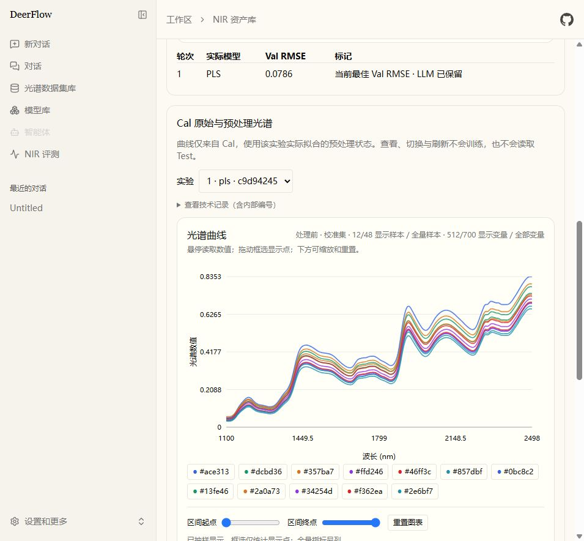
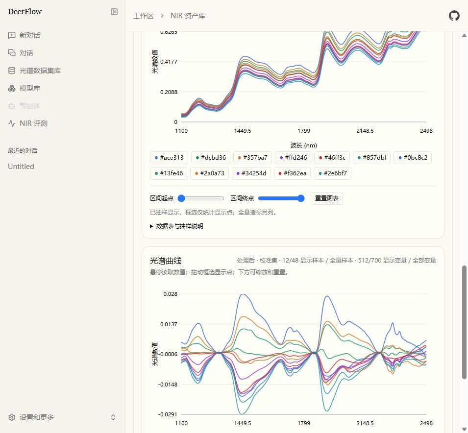

# ChemAgent 第六阶段实施报告

日期：2026-10-10。工作区：`D:\ChemAgent\nirs-agent`。分支：`dev/Duan`。

**结论：本阶段完成了真实 Corn 数据适配、成本与合同修复、Cal 光谱对照和本地回归，但真实完整流程验收未通过。** 唯一获授权的 DeepSeek 网页运行自主执行了一个真实模型实验，之后由 LLM RETAIN 并冻结。终结调用的 token 准入额度不足，未执行最终 Test，也未生成最终模型报告交付。没有观察到真实主动 STOP，亦没有两次成功数值执行。修复后未追加真实调用，不能以 Fake LLM 成功代替这些验收结果。

本轮没有提交、推送、checkout 或 reset；没有进入论文对比、消融、跨任务经验复用或其他研究阶段。第一至第五阶段未提交成果、真实失败记录及历史 Corn 工件保留。

## 1. 现有系统检查

已检查决策审计、LLM 设计、路线图、第一至第五阶段实施报告及第四阶段最终验收报告，并核对根目录、backend、frontend 的 `AGENTS.md`、实际配置、工作树与真实运行证据。开始与结束 HEAD 均为 `ef288ea3ec241507c63164828a012a2fd519a440`。

实际链路仍为 DeerFlow Lead Agent → 现有中间件和协调 Skill → `nir_workflow` → `nir_prepare_search` → `nir_decision_context` → `nir_submit_decision` → `nir_execute_decision` → 现有安全搜索内核 → Feedback。STOP/预算 RETAIN 后使用原有 Freeze、Finalize 和交付服务。ProcessStore 仍为 v5；没有新建 Agent、分区、搜索、实验持久化或 memory 系统。

自主模式继续强制 `decision_strategy="llm_autonomous"` 与 `search_protocol="sealed_holdout"`；模型、预处理、参数策略、后续动作和正常 STOP 的控制权仍属 LLM。程序只验证合法性、硬约束、执行一致性及资源上限。只有已接受的 decision_id 可以执行；legacy、直接 search、MCP fit、脚本和原始文件等绕行路径继续被阻止。legacy 模式保留原工具和 Skill 内容。

运行配置中的安全工具已经注册。根 `config.yaml`、密钥、包清单和锁文件未改动。本次真实验证使用独立 `.tmp` 配置与运行目录；标题、建议和跨任务记忆关闭，Lead 单次输出限制 4096，但通用摘要当时仍启用，其额外成本见第 5 节。真实运行结束后 Gateway 以禁止 provider 调用的只读验收方式提供该页面，辅助模型也禁用，没有恢复付费搜索。

第五阶段报告中的成功网页交付使用合成数据、一次数值实验和预算 RETAIN；不能据此认定真实 NIR 多轮交付或主动 STOP 已通过。本阶段确认的两个实际问题是自定义网页预算仍继承 development 的 LLM 额度，以及整个协调 Skill 的 legacy 说明被每次重复发送。

进一步按 RunJournal 与 HTTP 日志对账，发现通用摘要中间件还在 NIR 准入账本之外发起辅助模型调用。本轮全部 API 请求与 Lead 决策收据不是同一统计范围；详见第 5 节和补充成本审计。此问题已作本地修复，但没有追加真实验证。

## 2. 真实数据集适配

### 2.1 数据盘点与选择

| 数据 | 实际检查结果 | 本轮处理 |
| --- | --- | --- |
| Tecator | 240 行、125 列包含 100 光谱变量、22 个预计算 PCA 列及 3 个目标；有 24 组重复光谱、12 组跨既有分区；实际波长点轴未完整提供，公开 Test 暴露历史无法确认 | 报告风险后，用户要求更换；没有训练或评价其 Test |
| Wheat 工作簿 | 厂商 A/B 校准含同一编号的重复测量，Test 与 Cal 存在编号重合；部分 Val 缺 Protein；厂商 C 缺完整 Cal，仪器变量数不同 | 没有混合仪器、补造目标或重新制造确认集 |
| Wheat kernels MAT | 可读 Cal=415、原 Test=108、100 个变量；说明包含品种、地点和月份差异，但目标单位及可用于分组的逐行身份不足 | 未用于建模 |
| Corn | 原 MAT 中 m5、mp5、mp6 为同批 80 个样品的三个仪器；m5 为 80×700，目标标签明确，单仪器无缺失或完全重复光谱 | 经用户接受，选 Corn/m5 的 Oil 单目标功能验证 |

没有用随机数据冒充真实 NIR，也没有把三个仪器的同一批样品堆叠成 240 个独立样品。

### 2.2 本次数据身份与限制

源文件：`C:\Users\echo\Desktop\真实数据集\定量分析\Corn_Gasoline_NIR\extracted\Supplementary Material\1. Public NIR testing data\1.1 corn.mat`。

版本以文件内容识别：SHA256 `e28fd4be274a54ca57b1f2c67ef5a8bf4981f8314bcc73e4c64836fe658c46b5`。MAT 内 datasetversion 为 `4.0`，这是结构字段，不推断为外部数据发布版本。公开来源说明的样品数、仪器和波长范围可在 [Eigenvector 数据集页](https://eigenvector.com/resources/data-sets/)核验。

- 光谱矩阵为样本×变量，即 80×700；只使用 `m5spec.data`。
- 波长轴为真实源轴，1100–2498 nm、间隔 2 nm、升序。
- 目标由 `propvals` 的明确标签 `Oil` 定位，索引 1；不按文件名猜测列号。
- **目标单位源文件未注明，不写成百分比。** RMSE、MAE、bias 使用源目标数值单位，R²/RPD 为无量纲。
- X/y/axis 有限、形状和方向一致；没有完全重复的 m5 光谱。数据未提供逐行批次/来源分组标识，不能证明不存在潜在批次相关性。
- 同批 Corn 光谱曾用于项目水分建模；历史 Test 成员是否完全重合无法核验。用户明确接受“已有公开数据上的功能验证”，本报告不称其为既往未暴露的独立确认集。

### 2.3 固定划分与协议

`prepare_nir_corn.py` 复用现有 `split_dataset`，在训练前一次固定 seed=42、Cal/Val/Test=48/16/16。没有按模型效果重划 Test。适配结果 `.tmp/phase6-data/corn-m5-oil.npz` 的 SHA256 为 `0850054f2b3c278da0e0f18fe4d90c789e3116d3cb44258c76db2ebe2b572fbd`；同目录 manifest 保存源 hash、目标映射、原始行索引、划分配置及历史使用声明，创建时拒绝覆盖。

Cal 内使用 5 折 KFold、shuffle=True、random_state=42；每折训练样本数 38/38/38/39/39，验证样本数 10/10/10/9/9。实际折成员和 manifest hash 存在可信记录中。没有已知重复或分组 ID 时不伪造 GroupKFold；对于将来带有真实 group 的数据仍使用现有分组协议。

Cal 用于 CV 和拟合，Val 用于反馈与方案选择。状态型预处理每个 CV 训练折独立 fit，再 transform 对应验证折；全 Cal 拟合状态用于 Val 与冻结。Test 被准备服务写入私有封存分区，搜索上下文、图表和执行器不读取该分区。

本地真实数据适配验证执行四个固定模型（PLS/Ridge/SVR/ET），合计 24 次拟合；另用真实 Corn 的 Cal/Val 执行两轮 Fake 决策参考实验，12 次拟合。两者均为本地功能检查，不属于真实 LLM 的模型选择，也没有评价 Test。

## 3. 实际代码修改

以下为**第六阶段**增量，未将整个未提交工作树误计为本阶段修改。

| 文件 | 实现与复用 |
| --- | --- |
| `backend/scripts/prepare_nir_corn.py`（新增） | 验证 MATLAB 标签、方向、波长与重复行；复用划分函数，输出不可覆盖 NPZ/manifest |
| `community/nir/cal_spectra.py`（新增） | 实际模型拟合后从 Cal 和已拟合预处理状态采集有界曲线，不 fit、不优化 |
| `community/nir/dataset_session.py` | 验证可选 `wv_unit`；保存曲线 hash；图表缓存失败单独记录，不冒充模型训练失败 |
| `community/nir/autonomous_view.py`、`backend/app/gateway/routers/nir_process.py` | 复用 owner/thread/session 权限提供光谱缓存 GET；校验身份、hash、大小与路径，缺失旧缓存不补算 |
| `community/nir/decision_provider.py`（新增） | 提供 provider 专用投影与逐部分 UTF-8 字节计量；不改变持久化上下文和决策 |
| `community/nir/decision_origin.py` | 在现有真实模型响应收据中另存 request_profile；actual usage 保持原始来源 |
| `agents/middlewares/nir_workflow_middleware.py` | 当前阶段工具视图、上下文/Skill 投影、幂等 Schema 绑定；排除框架注入消息对用户启用标志的误识别 |
| `agents/middlewares/summarization_middleware.py` | 在可信自主网页入口和 llm_autonomous 状态中跳过额外摘要模型，复用现有证据上下文/压缩；legacy 不变 |
| `community/nir/decision_schema.py`、`decision_tools.py` | proposal 与 EvidenceClaim 的 evidence_refs 使用真实 ID enum；错误修正返回同一允许 ID 列表 |
| `community/nir/web_entry.py` | custom 使用服务端上限内的 autonomous 默认额度和用户四项训练预算；复用 resolve_policy 的严格校验 |
| `frontend/src/core/nir/autonomous.ts`、`process-hooks.ts` | 有界 Cal 曲线解析与只读、惰性查询；验证身份、轴顺序、有限值、数量及前后对齐 |
| `frontend/src/components/workspace/nir/cal-spectra.tsx`（新增） | 实验选择、真实参数说明和前后光谱；复用 ProcessChart SVG/缩放 |
| `autonomous-process.tsx`、`autonomous-mode.tsx` | 嵌入光谱视图，区分 OOF 与 mean-fold RMSE，按真实缓存显示提示，更新自定义额度说明 |
| 新增后端测试 `test_nir_cal_spectra.py`、`test_nir_corn_adapter.py`、`test_nir_provider_cost.py` | 数据适配、真实预处理状态、权限/隔离、投影合同、来源与字节计量 |
| `test_nir_autonomous_summarization.py`（新增） | sync/async 自主入口与活动状态均不调用辅助模型、不修改证据；legacy 摘要仍可用 |
| 修改后端测试 `test_nir_autonomous_router.py`、`test_nir_web_entry.py`、`test_nir_web_entry_agent.py` | 只读路由、服务端额度绑定、实际 Skill 注入后的 Fake STOP/RETAIN 全链路 |
| `frontend/tests/unit/core/nir/cal-spectra.test.ts`（新增） | 曲线合同、非法元数据、真实 SVG 输出与缺失旧缓存 |
| `README.md`、三个 `AGENTS.md`、本报告及证据文件 | 同步能力与真实未验收项 |

表中 `community/nir` 位于 `backend/packages/harness/deerflow/community/nir`，`agents` 位于同一 `deerflow` 根。`safe_search.py`、参数 adapter、数据分区逻辑、`decision_budget.py`、既有决策合同/存储、Lead Prompt 和完整 Skill 文件没有为本阶段重写。原始 Skill 的内容与 hash 保持不变。

## 4. 唯一授权的真实 LLM 运行

真实 provider：当前 DeepSeek `deepseek-flash`。入口是网页自然语言任务，实际 DeerFlow Lead Agent、真实 NIR 工具与数值训练，没有手工注入模型选择或 STOP。

- thread：`97d5ac14-d4a8-4585-865c-480b97011fa2`
- run：`18e8faec-3181-4504-8d01-f45b77c7e144`
- session：`search_16f80da7bc014f7484032b16f99ba223`
- 搜索硬界限：8 实验、160 fits、24 动作、1800 秒；终结 6 响应、50 万准入单位、300 秒。
- 用户授权的搜索 provider 上限为 36 响应、270 万准入估算；额外验收总界限为 44 响应、340 万估算、2400 秒，单次输出最多 4096。
- **实际旧 custom 绑定的是 development 的 30 响应/120 万搜索准入额度**，虽然服务器 ceiling 为 36/270 万。这是失败原因之一，而不是拟合预算耗尽。

本次执行前只核对了服务器 ceiling，遗漏了会话实际绑定额度；这是本轮准备检查的遗漏。旧会话政策没有在失败后被改写或补充额度。

额外验收 launcher 的总额度保护原先替换 Lead 模块的全局类名，但实际 `build_middlewares` 在函数内部从中间件模块导入类，导致该额外 QA guard 未进入真实堆栈。持久化的现有搜索/终结预算仍在执行。事后可确认全部 18 个 provider 请求低于授权的 44 次，总墙钟 133.283 秒低于 2400 秒；**由于辅助调用缺逐请求准入数据，不能确认总字节代理上限和每个辅助调用输出上限全部得到执行**。已修正替换位置，`--check-local` 检查实际堆栈且不调用 provider；不能声称修正后的 QA guard 已在真实运行中验证。

### 4.1 实际序列

| 顺序 | 实际决策/工具与结果 |
| --- | --- |
| 1 | 自然语言任务启动封存自主模式；prepare 一次，获取 Cal 诊断与方法知识 |
| 2 | 首个 EXPLORE 提案使用了不在当前 context 中的证据 ID，明确拒绝，未执行模型 |
| 3 | LLM 修正并接受 `decision_5a252d6d72704a1094e22de97fed6b25`：AsLS(lambda_=100000,p=0.001) → mean_center → PLS；固定 n_components=8、scale=False、max_iter=500、tol=1e-6 |
| 4 | 执行 `exp_9edd47b199101f19a842571fc9d94245`；1 参数候选×5 CV 折+1 全 Cal 拟合，共 6 fits；耗时 0.219 秒；返回完整 Cal/Cal CV/Val 指标与真实参数 |
| 5 | LLM 读取实际 Feedback，提出 CHANGE_PREPROCESS：airPLS 与导数方向；`airpls.ratio` 非法，返回允许值 `lambda_ / max_iters / porder`；未执行第二个模型 |
| 6 | 下一次搜索请求超过剩余 LLM token 准入额度，stop_source=budget、原因 llm_tokens；仍有 154 fits，不允许继续训练 |
| 7 | 终结阶段 LLM 提交 `decision_c8de5da76cb775b33c6ee89ecbd95189`，RETAIN 唯一真实成功实验，说明质量未达标与未探索方向；不产生拟合 |
| 8 | `nir_freeze_search` 冻结被明确指定的原 Cal 模型；没有程序替代选最好实验 |
| 9 | 终结 50 万额度中已计入 481353，剩余 18647 不足下一次请求；状态 finalization_unavailable。`nir_finalize_search` 调用为 0，Test 评价为 0；模型报告交付未完成 |

审计全部 164 个根 checkpoint，按 tool_call_id 去重，工具次数为 workflow=1、prepare=1、context=4、submit=4、execute=1、history=1、freeze=1、finalize=0。两份拒绝记录独立保存，不篡改为成功决策。阶段和候选 action 没有被程序转换成指定家族、隐式训练或 STOP。

完整真实证据： [chemagent-phase6-real-llm-evidence.json](./chemagent-phase6-real-llm-evidence.json)。私有日志、SQLite 状态、原始请求/响应和一次授权凭据留在 `.tmp/phase6-web-20261010-home`、`.tmp/phase6-gateway-real.log` 及对应证据文件中；没有删除失败运行。

### 4.2 科学理由核验

LLM 首轮引用 Cal 的 baseline_drift_score=0.4205、低高频噪声/尖峰、光谱维度与小样本条件，选择基线校正与潜变量回归；它明确将诊断视为证据，而非强制执行规则。知识记录包含 PLS/Ridge/SVR/Extra Trees 及基线相关方法卡片；检索相关性未被当成预测性能排序。检索到的基线卡片不是 AsLS 效果的实验性证明。

后续 CHANGE_PREPROCESS 的理由确实引用了上一实验 Val 与 CV 差距、Val slope≈0.733、残差趋势等真实反馈；但提案因非法参数未执行。反馈保存原 decision_id、experiment_id、实际配置/参数、CV manifest、预算和 `expected_improvement`，原理由保持不可变。

首轮“优于 Raw PLS”只是 LLM 预期，**Raw PLS 候选没有训练**；因此改善状态是 `not_evaluable`，没有虚报提升。`n_components=8` 能规避过拟合也只能视为待检验假设，不能因低于样本数就保证泛化。当前只有一个成功实验，不足以核验连续收益、重复参数区域处理或真实模型切换后的效果。

### 4.3 失败后修复边界

1. custom 入口改用**服务端 ceiling 内**的 autonomous 默认 LLM 额度，development 不变；用户只能覆盖原四项训练资源字段，不能写入隐藏调用/token 上限。既有会话额度不会恢复或重置。
2. 自主 provider 只接收完整 Skill 中的 Phase 1–4 与 Runtime Validation 协议段，去除后续 legacy 操作说明；用户请求与源 hash 保留。未通过 hash/结构验证则保留原消息，不偷偷生成替代 Skill。
3. 校验 Schema 将 evidence_refs 限定为 context 中实际 IDs，拒绝合同返回准确允许列表，减少不可修复的引用猜测；参数合法性、真实来源、动作和用户约束未放宽。
4. 排除 framework Skill/durable/dynamic 注入消息中的文字标志，防止 legacy 请求被注入 Skill 中的自主说明误判为用户开启自主交付。
5. 修正独立验收 launcher 的 guard 绑定，保留一次运行消耗标记；真实 provider 关闭后继续本地验证。
6. 通用摘要的 `_summary_model.ainvoke` 在 before_model 中单独调用 provider，绕开 NIR 搜索/终结 ledger。自主网页准备期及活动 llm_autonomous 会话跳过该分支，依靠既有真实 DecisionContext 与消息压缩；没有调用另一模型来生成历史事实。sync/async 与 legacy 摘要回归、真摘要中间件参与的 Fake 交付已通过。

带实际 SkillActivationMiddleware 与 ToolOutputBudgetMiddleware 的 Fake Lead 测试覆盖两轮数值执行、主动 STOP 与预算 RETAIN 的 Freeze→Test→Report；终结仍用原 6 响应/50 万上限。修复没有无限增额，**这些仅是本地验证**，未对上述真实失败会话重新 Finalize 或消耗 Test。

## 5. 决策成本与上下文优化

### 5.1 本次准确 usage 与输入规模

**本轮全部真实 API 成本为 18 次响应、input=467891、output=26428、total=494319 tokens**，来源为 RunJournal 的实际 provider usage 回调及完成时持久化的 runs 行；HTTP 日志也有 18 次成功请求。13 次 Lead 响应为 input=418368、output=10378、total=428746，其余 5 次中间件辅助响应合计 input=49523、output=16050、total=65573；没有 subagent 调用。原真实证据 JSON 的 `lead_*` 字段准确描述 Lead 范围，并未改写，新增 [provider-cost-audit.json](./chemagent-phase6-provider-cost-audit.json)澄清全部费用范围。

Lead 搜索 9 次、终结 4 次，unknown_usage_calls=0；对应实际 tokens 为 295174 / 133572。其准入 charged_units 分别 1136533 / 481353，是保守字节代理加输出额度，不是计费 tokens。辅助请求当时未记入该 NIR ledger，不能以 Lead 准入计量声称覆盖全部 API。没有可靠货币费用换算，不写成实际金额。

逐响应 request_profile 可复现 **13 次 Lead 请求**的序列化输入规模，合计 1564638 UTF-8 字节；不包含 5 个辅助请求：

| 部分 | 累计字节 | 解释 |
| --- | ---: | --- |
| 系统提示 | 466091 | Lead 系统提示及当前阶段说明；基础提示约 35 KB/请求，尚未全面重构 |
| 完整工具定义 | 61500 | 按实际阶段转换后的 OpenAI 工具 Schema，不是工具名近似 |
| 用户任务和 Skill 消息 | 800891 | 包含重复的完整 Skill；不能把此合计精确分解成 task/Skill 的计费 token |
| DecisionContext 消息 | 123711 | 包含知识与实验反馈；子集计量不与主表再次相加 |
| 工具返回与修正 | 59967 | prepare、执行、拒绝和历史等工具证据 |
| assistant 历史 | 51855 | 决策与交付叙述；此次未完成最终交付说明 |
| JSON 序列化开销 | 481 | 与组件合计的差值 |

这是字节组成，不是逐部分 tokenizer 计费。领域卡片和历史是 Context 的子集；不虚构准确的逐模块 token 数。

页面聊天头曾显示 494274 tokens，与最终线程总计 494319 仅差 45；428746 是 Lead 范围，两者不能直接比较或据差额推断重复计费。run_events 使用 memory 后端，Gateway 重启后逐辅助响应事件不再可读；保留的 RunJournal 累计与 5 版 summary_text 的身份/字符数可核验，辅助单次 caller/output/输入字节无法完全重建。没有保存 summary 正文作为新科学事实，也没有编造逐调用 token 分配。

### 5.2 已实现的压缩

- 复用阶段工具视图与既有消息压缩，只暴露当前允许的过程工具；交付后只显示相应状态/审批工具。
- 完整 DecisionContext 保持持久化；provider 消息省略已在 submit 工具中绑定的重复 proposal_schema，明确标出 Schema 来源。
- provider 省略 Cal CV 每折逐行成员，保留实际 splitter、折数、seed、fold_sizes、manifest ID/hash；精确成员仍可审计。
- 每轮保持现有有界历史、当前/最佳/保留实验关键反馈与按需分页，不重复注入所有 trial 明细；没有第二套 memory。
- 对真实 hash 验证的 Skill activation 消息去掉 legacy 段；所有自主科学/控制协议与用户硬要求保留。
- 自主模式跳过通用 LLM 摘要分支，消除已经发现的预算外辅助调用入口；保留原有确定性消息压缩和数据库历史读取。legacy 摘要仍正常运行。
- 所有压缩只作用于模型请求副本；context_id/revision/hash、参数合法范围、用户约束、历史身份、反馈、证据来源和预算继续有效。光谱矩阵与图表曲线不送入 LLM。

### 5.3 成对本地参考

以同一真实 Corn Cal/Val 上持久化的 Fake 两轮实验为参考；前后使用同一 context_id/hash、用户任务、能力与完整合法 Tool Schema。额外压缩只删除重复内容，不生成摘要事实。

| 固定阶段 | 优化前字节 | 优化后字节 | 减少 |
| --- | ---: | ---: | ---: |
| initial | 151082 | 88672 | 62410（41.3%） |
| 第一轮 Feedback | 156756 | 94437 | 62319（39.8%） |
| 第二轮 Feedback | 162346 | 99706 | 62640（38.6%） |

数据见 [chemagent-phase6-cost-reference.json](./chemagent-phase6-cost-reference.json)。Fake 完整调用验证压缩后仍能合法提交和执行，来源与合同校验通过；加入真摘要中间件后辅助模型 invoke/ainvoke 次数均为 0。此对照 provider_calls=0、Test evaluations=0；**不等于真实计费 token 降低 39%–41%**。第五阶段 492309 为 Lead 范围，不能与本轮全部 494319 tokens 混比；任务与终态也不同，不进行因果归因。修复后真实 token 成本及无效提案率仍待逐次授权的验证。

## 6. Cal 光谱预处理可视化

可信执行服务在本轮真实模型成功后，用已拟合的 `model.preprocessor.transform` 生成 Cal 曲线。AsLS 逐光谱基线校正之后，mean_center 使用全 Cal 拟合的中心；其 Chemotools adapter 是 ParetoScaler(p=0)，并未擅自改为 Pareto 缩放。图表不会 refit、改变模型或重跑搜索。

最多均匀选择 12 个真实 Cal 行与 512 个有序原始通道；本次为 12/48 行、512/700 通道，波长单位 nm。前后使用相同行身份和轴下标，不伪造点，不将抽样曲线写成全量光谱。CV 性能仍来自全量 Cal 折内执行，不来自展示子集。

缓存与 session/experiment/decision、实际有序预处理参数及模型 hash 绑定，字节 hash 为 `aa59bc17dbbc7f88e6c90daad345aac98b481c368f8a42c9a89bc27f3c78bb1f`。GET 路由仅读取 hash 校验的缓存，校验 owner/thread/会话与工件身份、大小、符号链接和路径；没有 np.load/joblib.load、Test 文件访问或补算。旧模型缺缓存显示未记录。

网页现有“验证与图表”页签可查看原始与处理后两张真实曲线、实验、顺序及实际参数，复用 SVG、缩放和缓存查询。真实页面已目视核验，刷新恢复后显示同一曲线。刷新前后 session、decisions、model responses 的持久化 hash 完全一致：仍为 1 实验、6 fits、13 响应、finalization_unavailable、Test 未评价。查询阶段 provider 禁用。

截图保存在 `docs/chemagent-phase6-evidence/`：原始曲线来源与抽样说明、真实处理后曲线、刷新后的状态。它们展示实际失败会话，不冒充已完成的 Test 图。

真实网页为 localhost 开发环境、owner=default；生产认证的真实端到端验收不在本次证据范围。权限否定、缓存篡改和不补算由自动化验证。以下截屏是本会话真实 Cal 曲线，最终 Test 仍未评价。

## 7. 科学验证与实际模型效果

真实首轮模型实际参数：`copy=True, n_components=8, scale=False, max_iter=500, tol=1e-6`；预处理顺序和参数与接受的 DecisionProposal 完全一致。

| 范围 | n | RMSE | R² | RPD | 来源 |
| --- | ---: | ---: | ---: | ---: | --- |
| Cal | 48 | 0.0443007085 | 0.938596937 | 4.078276537 | 全 Cal 拟合后的校准预测 |
| Cal CV OOF | 48 | 0.0627047494 | 0.876981743 | 2.881289560 | 全部折外预测统一计算 |
| Val | 16 | 0.0786348942 | 0.828016644 | 2.490411723 | 留出验证 |
| 最终 Test | 16 封存 | 未评价 | 未评价 | 未评价 | finalize 未调用，无合法最终结果 |

参数 trial 的 **mean-fold RMSECV=0.0625634160**，五折 RMSE 分别为 0.0579630797、0.0655591174、0.0668136435、0.0606994659、0.0617817736。该均值与 OOF RMSE 0.0627047494 不同；前端与报告已分别标识。

默认 Val 质量门禁要求 R²≥0.8、RPD≥3.0，本模型为 fair、passed=False；Val slope=0.732962753、bias=-0.011760445。R² 通过不等于整体质量达标；Oil 单位未知也限制应用误差解释。门禁建议保留为科学诊断，不替 LLM 强制选择下一动作或 STOP。

Test 没有用于反馈、绘图或选模，也没有为获得更好结果重划或评价。已有公共数据暴露历史、样本量与未知批次分组限制仍须披露。本次数据功能测试不能证明方法优于其他建模方法。

## 8. 模型、报告与交付状态

冻结实验与 LLM RETAIN 指定实验相同。冻结完整模型/预处理工件 SHA256：`3c5601d8d950819dc63b7de8a34195880960a6cedf0da38438d46ad105321512`；CV manifest：`cv_f8d479ce3cdfb72c8c58f3408a8a07503dde244c240842d80a50b3c6793f1c19`。没有 Cal+Val 再训练，也没有替换参数或预处理。

仅对本次可信生成并校验 hash 的内部工件进行加载，用 3 行 Cal 验证预测有限；没有加载来历不明 pickle，没有读取 Test，也没有新拟合。内部模型与原决策及实际配置一致。

**真实运行的最终 Test、模型导出、报告、ZIP、网页下载尚未完成；未审批、未注册。** 该内部工件可加载不等于最终交付通过。本报告是开发实施报告，不是该模型已完成的最终建模报告。

Fake STOP/预算 RETAIN 全链路验证能冻结明确指定成功实验、Test 唯一 lease、报告指标范围、工件和只读刷新；保留早期实验可与最低 Val 不同。第一至第五阶段单次 Test、失败闭锁、用户取消、交付恢复、审批和注册约束的相关自动化继续执行。未获审批或质量失败不能自动注册。

## 9. 测试结果与保存证据

| 检查 | 最终结果 | 证据 |
| --- | --- | --- |
| 修改前全后端 | 6493 passed / 86 failed / 45 skipped | `.tmp/phase6-baseline.xml/.log` |
| 最终全后端 | **6518 passed / 88 failed / 45 skipped**，409.60 秒 | `.tmp/phase6-final4-backend.xml/.log` |
| 全部后端 NIR（包含阶段 1–5） | **845 passed / 2 skipped**，85.62 秒 | `.tmp/phase6-final5-nir.xml/.log` |
| NIR 数值内核 fast | 670 passed / 2 skipped / 26 deselected | `.tmp/phase6-core.xml/.log` |
| NIR 数值内核 slow | 26 passed / 1 skipped / 671 deselected | `.tmp/phase6-core-slow.xml/.log` |
| 真 Skill 注入 Fake STOP/RETAIN 完整流程 | 4 passed（两种终态×有/无 Skill） | `.tmp/phase6-skill-integration2.xml/.log` |
| 辅助调用修复与真摘要/Skill Fake 链路 | 30 passed（含上述 4 条完整链路） | `.tmp/phase6-aux-green2.xml/.log` |
| 前端全单元测试 | **578 passed，66 文件** | `.tmp/phase6-front-full-final.log` |
| TypeScript | `tsc --noEmit` exit 0 | `.tmp/phase6-front-typecheck-delivery.log` |
| Ruff（本阶段 Python 文件） | All checks passed | 本阶段文件列表 scoped check |
| ESLint | 环境阻断：eslint resolver 缺 `unrs-resolver` | `.tmp/phase6-front-eslint.log` |
| 真实 Corn 本地安全数值执行 | 四家族固定模型+Fake 两轮参考，Test=0、provider=0 | `.tmp/phase6-offline-evidence.json` |
| 唯一真实 DeepSeek 网页 | 全部 18 响应（13 Lead+5 辅助），1 成功实验、6 fits、RETAIN/冻结成功；Test/交付失败 | 真实 JSON、补充成本审计、私有状态和日志 |

**没有报告全量回归全部通过。** 最终的 88 个失败中，86 个也在第六阶段修改前出现；多出的 `tests.test_run_manager::test_list_by_thread[asyncio]`（快速创建记录时间戳相同的排序断言）与 `tests.test_mcp_file_migration.TestWorkspaceSnapshots::test_changed_workspace_files_detects_created_and_modified_files`（同大小文件改写时间戳检测）涉及未改动的源码/测试。与第五阶段最后全量的失败集合比较，本次没有新增失败节点。前一轮 6513/87 的全量中后一项曾通过；这种 Windows 时序差异另留日志，没有被抹去。具体 node IDs 与集合比较见 [chemagent-phase6-local-validation-evidence.json](./chemagent-phase6-local-validation-evidence.json)。

全量残余失败涉及既有 POSIX 权限/符号链接、沙箱与上传、配置/通道/路径等跨平台检查；没有自动修改这些公共模块来制造绿色全量。两项 NIR 跳过是当前 Windows 账户无法创建符号链接的上传/交付检查；内核跳过包含 knowledge vectorstore 的 collection skip，以及 Windows uv 启动孙进程问题下的 stdio MCP 回合测试（需 Docker/Linux 复核）。ESLint 不能因 TypeScript/单元测试通过而记为通过，也未联网安装缺失包。

本轮 pytest 使用隔离 DEER_FLOW_HOME 与唯一 basetemp；修复过程中重用固定 Fake thread 的运行曾因非隔离持久状态导致测试失败，之后使用新测试根重新验证，原日志保留，不删除业务状态。加入真实摘要 hook 后，Fake 图的额外节点触发原 recursion_limit=45；仅测试图上限调整为 70，任务拟合/实验/模型调用预算没有增加。最终 30 项专项及全 NIR 均通过；一次过渡全量被停止，其日志保留，不记为最终验证。全量/NIR/Fake 最终结果都来自隔离目录。

数据、来源、范围、预处理 fold 状态和 Cal 缓存有专门测试；安全搜索、Test spy、动作控制权、参数授权范围、两轮反馈与不可变理由、预算累计、STOP/RETAIN、冻结唯一 Test、权限、legacy、工件与审批约束由全 NIR 回归共同覆盖。真实运行没有覆盖的动作不会写成真实验收成功。

保护检查覆盖开始时的 113 个工作树文件；无文件丢失，原阶段报告/真实证据不变，`config.yaml` 不变；9 份历史 Corn 输入/模型/报告类文件 hash 均一致。代码改动仅为本报告增量列出的文件及文档，新证据不覆盖旧实验。

## 10. 已实现、已验证与后续条件

| 状态 | 内容 |
| --- | --- |
| 已实现且本地验证 | Corn 适配、固定划分、四家族安全执行、阶段上下文/Skill 压缩、自主摘要旁路关闭、成本范围对账、引用 Schema、custom 额度绑定、Cal 对照/只读路由、Fake 多轮 STOP/RETAIN 最终交付 |
| 已有真实证据 | Corn 首轮 LLM 选择与执行、真实 Feedback 驱动的后续提案（被参数校验拒绝）、预算 RETAIN、精确冻结、内部模型预测、真实 Cal 光谱与刷新恢复 |
| 部分验证 | 模型具有真实 Val 效果但质量未达标；反馈自主调整提案存在但第二次训练未发生；旧独立 QA guard 修复只作本地堆栈检查；辅助逐请求资源审计不足 |
| 尚未真实验收 | 两次以上真实数值执行后的交付；预算仍允许训练时的主动 STOP→Freeze→Test→Report；修复后实际计费成本与错误率下降；Corn 最终模型报告/下载 |
| 未在本阶段实现 | 新模型家族、第二研究工作、跨任务经验复用、外部方法对比与消融、全面前端/Agent 重构；不追溯补造已丢失的辅助逐响应事件 |

下一次真实验证前应核对**已绑定政策**而不只服务器 ceiling，检查实际构建的中间件堆栈及全量请求准入；持久化逐请求 RunJournal 事件以核验辅助成本，并确认自主模式不进入摘要 provider 路径。使用同一固定分区，先在不消耗 Test 的环境处理合同问题。不得续给旧失败会话完整预算、自动选模型或补造 STOP。需要新的逐次 API 成本授权；本轮不会自行追加第二次运行。

对于正式科学确认，还需要未被开发/研究观察的可信数据、目标单位和样本来源/分组说明；本次 Corn 功能验证不能代替该条件。未知单位、公开 Test 与历史暴露风险不会通过更好的 Val 数值消失。

## 11. 八项最终验收问题

1. **真实 NIR 上能否自主建模？** 已真实验证 Corn 上自主选择并完成 Cal/CV/Val 建模；本次完整最终交付未通过，不能回答“全流程已验收”。
2. **真实 LLM 能否根据上一轮反馈完成多次优化决策？** 已看到真实反馈驱动 CHANGE_PREPROCESS 提案，但被非法参数拒绝；只有一次成功数值执行，未完成多次管线执行验收。
3. **真实主动 STOP 后冻结、Test、交付是否观察到？** 没有。本次是预算 RETAIN，且只完成冻结。
4. **扩大训练预算后正常停止权是否仍属 LLM？** 是，代码与本地全部动作/终态回归没有固定轮数、R² 或失败次数 STOP；本次真实硬限来自模型调用准入额度，不计为自主 STOP。
5. **成本是否降低，证据是什么？** 同一持久化输入的序列化字节减少 38.6%–41.3%，合同与执行本地通过；修复后没有真实 provider 对照，实际计费降幅尚未验证。
6. **网页能否显示真实光谱、历史、Val 与最终模型？** 本次真实光谱前后、决策历史、Val 与冻结状态已显示并刷新恢复；最终 Test/下载未产生。最终模型下载能力只有此前及 Fake 验证，不能冒充本次 Corn 成功。
7. **Cal/Val/Test 是否隔离？** 本次封存协议有效，搜索/图表使用 Cal/Val、Finalize=0、Test=0；只读和 Test spy 等回归通过。仍需披露原公共数据的历史暴露，不能称为全新确认数据。
8. **模型、报告与决策能否一致复现？** 固定数据/折 manifest、实际参数、不可变决策、反馈、冻结 hash 和 Cal 预测一致；本次没有最终建模报告，完整交付一致性尚未真实验收。

本轮到此停止开发，保留上述真实失败与修复证据，等待下一步指令。
