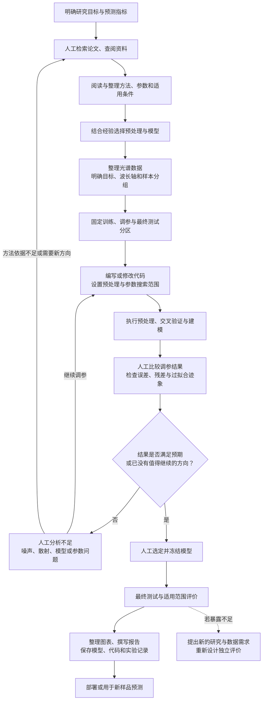
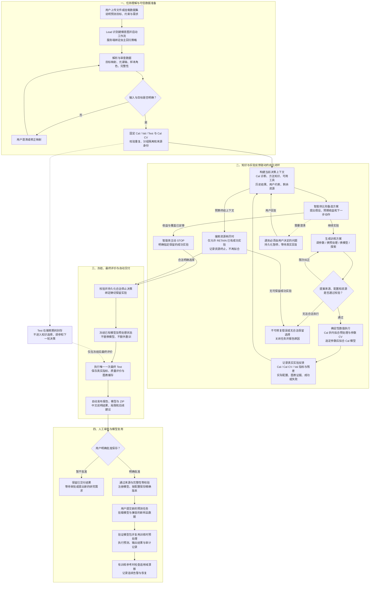
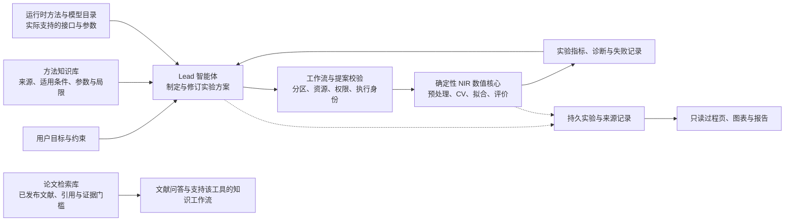

# ChemAgent 完整流程与传统人工建模对比

分析日期：2026-10-21。依据当前工作区源码、模块指南、回归测试定义及仓库保存的真实运行证据。本文聚焦近红外光谱建模，以**默认网页单目标自主回归**为主线；分类、多目标、校准迁移和历史训练入口作为独立能力说明。本次没有重新训练模型、访问 Test 或发起真实模型服务调用，也没有将已有测试文件的存在当作本次测试通过。

## 1. 项目定位与核心结论

**ChemAgent 将近红外建模中“查知识—选方案—做实验—看结果—再调整”的重复工作组织成可追溯的自主实验闭环，并连接数据管理、最终评价、报告交付、人工审批和模型复用。**

最值得突出的是三层协作：

1. **智能体负责决策。** 结合用户目标、Cal 数据诊断、方法知识、历史实验和剩余资源，比较方案，选择预处理、模型家族与参数范围，并决定继续或停止。
2. **数值工具负责计算。** 按已接受方案执行预处理、交叉验证、参数搜索、模型拟合和评价；在批准的参数网格内由数值结果确定参数，不私自扩大到其他模型或管线。
3. **服务端规则负责约束与记录。** 固定数据分区、封存 Test、校验调用来源与参数、记录实验和执行身份、约束资源使用，保留真实的人工审批。

这使“自主性”与“可验证性”同时成立。用户主要负责研究目标、必要的数据解释、结果审查和保存决定；连续实验中的机械操作由系统承担。

## 2. 传统人工建模循环

下面是用于对照的典型人工工作方式，并非声称所有人工研究都低效或缺少规范。专业研究者同样可以严格管理分区和实验记录，区别在于这些步骤通常需要人工组织、执行和维护。

人工投入集中在阅读提炼、方法到代码的转换、重复调参、结果对照和记录整理。用户所说的“建模效果不好，再重新看论文”，对应图中 **K → B → C → D → … → I** 的大循环。

这里用调参结果驱动循环；最终 Test 不作为反复选方法和调参数的反馈来源。最终测试暴露问题后，应如实报告，并为后续研究重新建立适当的独立评价。

## 3. ChemAgent 完整流程图

Cal 为校准/训练集，Cal CV 为 Cal 内部交叉验证，Val 为搜索中的验证/调参集，Test 为冻结模型后使用的最终留出测试集。**Val 已参与方案选择，不能当作最终独立性能证明；内部 Test 也不等于外部验证。**

与主线同时生效的机制：

- **过程可视化：** 数据准备 → 各轮原始输入/有序预处理/模型/验证/决策 → 最终评价 → 交付。图表绑定原实验身份与哈希，读取过程页不会重新训练或重新评价 Test。
- **实验记忆：** 保存执行前方案及理由、实际执行配置、反馈、失败、比较关系和保留关系。后续结果不会反过来改写原始假设；当前最好 Val、最终保留和最后一轮是不同概念。
- **运行约束：** 持续累计实验数、fits、调用数与时间等；无效 JSON 不能静默修复后执行。正常 STOP、预算 RETAIN、取消和失败分别记录。
- **恢复与交付：** 可信已完成结果可以复用；报告发布明确失败时可只重试发布。Test 或发布执行状态无法确认时需要审计，不盲目重新运行。
- **人工边界：** 澄清会暂停执行，页面点击不等于用户回答；自动生成报告不等于自动批准入库。

上述图中的“校验”由程序执行，不是每一轮都需要用户审批。新建单目标自主回归也不要求用户填写内部模式与预算开关。

## 4. 知识、决策、执行和记录如何配合

两种知识库应分别介绍：

| 知识来源 | 当前实现 | 对项目的价值 | 需要准确表达的范围 |
| --- | --- | --- | --- |
| 方法知识库 | 版本化方法卡；SQLite FTS5/BM25、中英文词展开、适用性与参数说明；决策上下文绑定知识快照 | 把“方法如何用、有什么限制”转为可检索的结构化依据，辅助自主实验设计 | 默认自主回归直接使用这一层；相关度不是最终选择规则 |
| 论文知识库 | 文档治理 SQLite + Chroma 向量检索；可配置 BGE-M3、第二阶段重排；章节/页码/文献身份与引用 | 支持研究资料检索、带来源的解释和领域问题分析 | 只检索已发布文献；证据不足可拒答；当前 sealed 自主搜索工具白名单不包含 `nir_search_knowledge`，不能画成每轮必调的论文 RAG |
| Chemotools 与执行注册表 | Chemotools 0.4.4、项目原生后备实现、能力目录与参数 Schema | 让可讨论的方法与实际可执行的方法对齐，保留提供者与版本 | 全目录可见不意味着全部能力可进入默认自主建模 |

因此，推荐的描述是：**“以方法知识和实验反馈驱动自主建模，并配备可追溯的论文检索能力。”** 如果未来要主张“每轮自动检索论文再决定实验”，需要显式接通当前受控搜索循环，并补充执行证据。

## 5. 与传统方式逐项对照

| 环节 | 传统人工组织方式 | ChemAgent 当前对应能力 | 值得强调的优势 |
| --- | --- | --- | --- |
| 提出任务 | 研究者把问题转成脚本、参数和操作步骤 | 自然语言说明目标，Lead 识别并启动受控流程 | 降低从需求到实验的操作门槛 |
| 查阅知识 | 逐篇查找、阅读、整理方法资料 | 结构化方法检索；另有带引用的论文检索 | 知识更易调用，出处与局限可保留 |
| 数据理解 | 手动核对矩阵方向、目标、波长与分组 | 置信度解析、来源校验、固定 Profile/划分；歧义请求纠正 | 减少格式搬运和不明确映射带来的错误 |
| 方案设计 | 依靠经验选择预处理、模型和调参范围 | 结合 Cal 特征、方法依据、约束与历史结果比较备选 | 能随任务与实测反馈调整方案 |
| 调参与训练 | 重复修改代码、启动实验、汇总指标 | 在通过校验的固定参数或显式网格中自动计算 | 连续执行可复核的数值实验 |
| 结果不理想 | 人工诊断后调参、换方法，或返回资料检索 | 依据持久反馈选择 TUNE、CHANGE_PREPROCESS、SWITCH_MODEL、EXPLORE | 把反馈真正接到下一轮实验动作 |
| 决定结束 | 研究者比较收益、复杂度与时间后停止 | 模型主动 STOP 并指定保留实验；预算终止独立标记 | 不只会继续尝试，也能保留更合适的历史方案 |
| 可信评价 | 由研究者与代码共同维护防泄漏规范 | 固定划分、折内拟合预处理、封存 Test、冻结后单次评价 | 将重要科学约束落实为执行边界 |
| 过程说明 | 手动维护笔记、参数表、图与运行编号 | 方案/实际执行/反馈分离，轮次关系与图表联动 | 回答“为什么试、实际做了什么、是否改善” |
| 报告与模型 | 手动整理图表、模型、预处理和说明文件 | 自动生成报告及模型包，审批后按配置保存版本 | 从实验到可复用成果的链路更完整 |
| 新样品应用 | 人工保证预测预处理与训练一致 | 精确模型挂载、包校验、原预处理复用、审计与漂移检查 | 将交付延伸到后续应用 |

这些是可由实现支持的操作与治理优势。没有同条件人工对照实验，因此本文不宣称节省固定百分比时间、降低固定金额成本，或保证预测精度超过专家。

## 6. 仓库中的真实案例：继续试验，也能回退保留

仓库保存了 2026-10-10 的一次 DeepSeek Lead / Corn m5 Oil 真实功能验收。报告与结构化证据相互对应：3 次实验、153 次 fits、4 个接受决策（含 STOP），最终 Test 事件计数为 1。

| 步骤 | 智能体动作 | 执行方案 | Val RMSE | Val R² |
| --- | --- | --- | ---: | ---: |
| 第一轮 | EXPLORE | SNV → 一阶导数 → PLS，潜变量搜索 1–10，选定 9 | 0.06939 | 0.86607 |
| 第二轮 | CHANGE_PREPROCESS | SNV → 二阶导数 → PLS，潜变量搜索 1–15，选定 15 | 0.05653 | 0.91110 |
| 第三轮 | TUNE | 保持第二轮预处理，潜变量搜索 16–20，选定 20 | 0.05711 | 0.90930 |
| 停止 | STOP | 明确保留第二轮；没有增加拟合 | — | — |

第二轮相对第一轮的 Val RMSE 降低约 **18.53%**，计算为 `(0.06939260296 - 0.05653485466) / 0.06939260296`。这只是本次内部方案迭代的变化，不是相对人工专家的性能提升。

第三轮略差，智能体结合已记录的 CV/Val、复杂度与剩余资源保留第二轮。停止时仍余 7 fits，记录中的一个未选固定候选需要 6 fits，因此该次终止记录为主动 STOP，而不是因拟合资源不足强制结束。

其后程序冻结第二轮模型，完成一次最终 Test 并自动交付；最终 Test RMSE 为 0.04790、R² 为 0.89973。该次运行仍为待人工批准、未注册状态，说明“交付完成”与“人工批准”没有混同。

**演示价值：** 这个案例具体展示了“提出新方案 → 实测验证 → 进一步探索 → 收益不足 → 保留历史方案 → 冻结交付”的完整闭环。

**证据范围：** 这是历史公开数据的功能验收，Cal/Val/Test 为 48/16/16，目标单位未注明，不能据此证明跨数据集的方法优越性。真实服务调用为 20 次、770282 tokens；没有可支持普遍成本更低或速度更快的同条件对照。

资料：[实施报告](chemagent-unified-autonomous-mode-report.md)、[结构化真实证据](chemagent-unified-evidence/real-corn-evidence.json)。

## 7. 展示项目时应保留的能力边界

- **自主回归当前模型族：** PLS、Ridge、SVR、Extra Trees。预处理与参数以当前注册表和受控适配器为准，不是所有 Python 算法都可任意执行。
- **波长筛选：** 项目其他训练入口有 CARS/SPA/manual 等能力，但默认 sealed 自主决策上下文的 `wavelength_selection` 当前只有 `none`。不要在这条主流程中画成每轮自动 CARS。
- **其他任务：** 分类、多目标、1D-CNN 与校准迁移属于项目的其他能力/入口；不能把它们说成当前默认自主回归循环均已支持的候选。
- **学习含义：** 后续决策使用本次任务已记录的实验反馈，不代表在线更新大语言模型权重，也不代表自主回归会自动吸收跨任务历史。该策略抑制跨任务记忆注入。
- **审批与质量：** 当前版本允许用户明确接受已评价但低于质量门槛的模型并保存，卡片保留未达标标记；原指标、科学校验、来源和完整性要求不被改写。保存不等于生产适用性证明。
- **库与监控条件：** 数据/模型库受功能与自动保存配置控制；预测漂移需要有效的训练参考，历史工件缺少时明确不可用。漂移告警不会自动授权重新训练。
- **人工介入：** 目标歧义、数据映射、必要领域条件、异常处置和模型保存决定仍可能需要人。适合宣传“关键节点有人把关的自主闭环”。
- **知识与准确性：** 方法卡、文献引用和检索分数支持决策审查，不能替代真实实验或保证结论正确。

## 8. 可直接用于汇报的项目表述

> ChemAgent 面向近红外光谱分析，将数据审查、方法知识检索、方案设计、数值建模和结果诊断连接为自主实验闭环。智能体依据每轮真实反馈调整预处理、模型与参数，并决定何时停止、保留哪一轮结果；系统通过固定分区、折内交叉验证、测试集封存和实验留痕保障过程可审查。最终自动交付报告与模型，经用户批准后进入模型管理与后续预测流程，使研究者能够把精力集中在问题定义、结果判断和科学解释上。

流程图旁适合放的六个标签：**知识辅助决策、反馈驱动迭代、自动数值执行、测试集隔离、全程证据追溯、审批后模型复用。**

## 9. 核查依据与代码入口

| 核查主题 | 关键实现/资料 | 本文据此确认的事实 |
| --- | --- | --- |
| 默认入口与服务端绑定 | [web_entry.py](../backend/packages/harness/deerflow/community/nir/web_entry.py)、[统一自主入口报告](chemagent-unified-autonomous-mode-report.md) | Lead 启动后绑定统一自主策略，历史模式保留 |
| 输入解析 | [schema.py](../nir_core/io/schema.py)、[search_tools.py](../backend/packages/harness/deerflow/community/nir/search_tools.py) | CSV/MAT 映射、可信准备、源文件身份和分区 |
| 决策与方法知识 | [decision_context.py](../backend/packages/harness/deerflow/community/nir/decision_context.py)、[decision_tools.py](../backend/packages/harness/deerflow/community/nir/decision_tools.py) | 知识快照、历史反馈、动作语义、提案校验和保留 |
| 工具与流程门禁 | [nir_workflow_middleware.py](../backend/packages/harness/deerflow/agents/middlewares/nir_workflow_middleware.py) | 阶段白名单、绕行限制、论文工具与 sealed 路径的区别 |
| 安全数值执行 | [safe_search.py](../nir_core/model/safe_search.py)、[parameter_control.py](../nir_core/model/parameter_control.py) | 四个模型适配器、参数边界、折内预处理、CV 选参 |
| Test 隔离与交付 | [dataset_session.py](../backend/packages/harness/deerflow/community/nir/dataset_session.py)、[automatic_delivery.py](../backend/packages/harness/deerflow/community/nir/automatic_delivery.py) | 分区固化、冻结既有模型、唯一 Test、确定性交付 |
| 过程与图表 | [autonomous_view.py](../backend/packages/harness/deerflow/community/nir/autonomous_view.py)、[轮次过程说明](nir-round-process.md)、[前端模块指南](../frontend/AGENTS.md) | 只读投影、缓存校验、轮次/步骤联动和历史缺失说明 |
| 论文检索 | [knowledge.py](../backend/packages/harness/deerflow/community/nir/knowledge.py)、[vectorstore.py](../nir_core/knowledge/vectorstore.py)、[evidence.py](../nir_core/knowledge/evidence.py) | published 过滤、引用、独立文献数量与证据门槛 |
| 方法知识层 | [方法知识说明](nir-method-knowledge.md)、[methods.py](../nir_core/knowledge/methods.py) | 结构化方法卡与论文向量库各自的职责 |
| 用户等待与审批 | [user_wait.py](../backend/packages/harness/deerflow/community/nir/user_wait.py)、[registration.py](../backend/packages/harness/deerflow/community/nir/registration.py) | 持久暂停、真实回复、明确批准与质量状态保留 |
| 模型管理与预测 | [模型库说明](nir-model-library.md)、[model_autosave.py](../backend/packages/harness/deerflow/community/nir/model_autosave.py)、[io_tools.py](../backend/packages/harness/deerflow/community/nir/io_tools.py) | 精确版本、配置控制的保存、预测审计与训练参考漂移 |
| 现有回归锚点 | [Test 封存](../backend/tests/test_nir_test_sealing.py)、[自动交付](../backend/tests/test_nir_automatic_delivery.py)、[统一 Agent](../backend/tests/test_nir_unified_agent.py)、[未达标审批](../backend/tests/test_nir_quality_approval.py) | 已阅读测试定义，本文未重新运行或声称新的通过结果 |

当前目录存在其他尚未提交的源码及文档修改；本分析读取当前工作区状态，仅新增本文，不覆盖这些已有改动。
